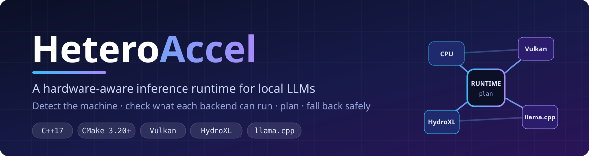
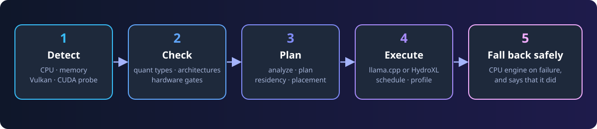
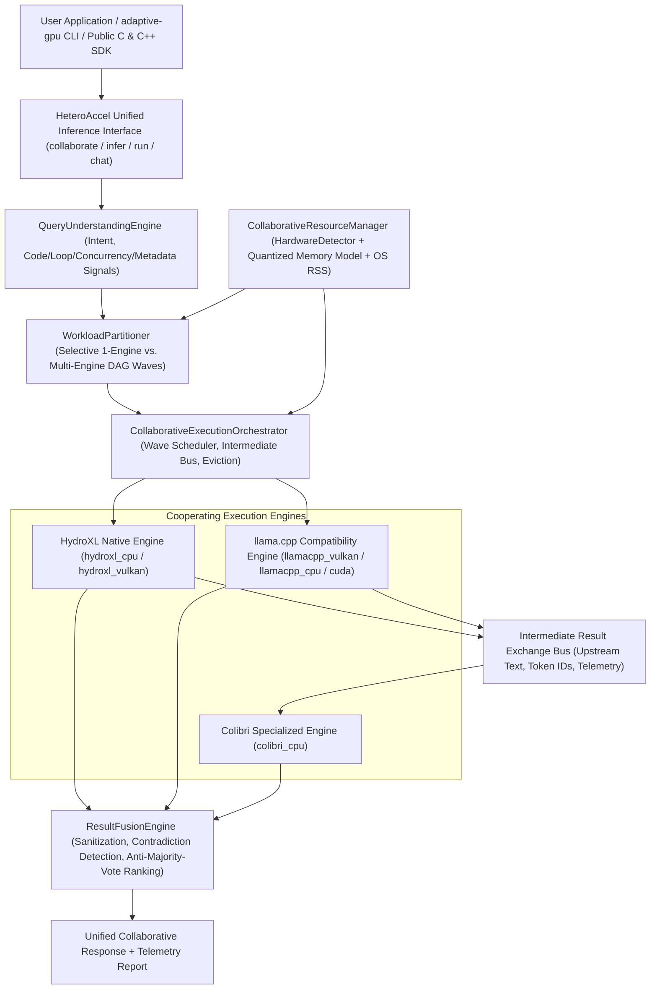
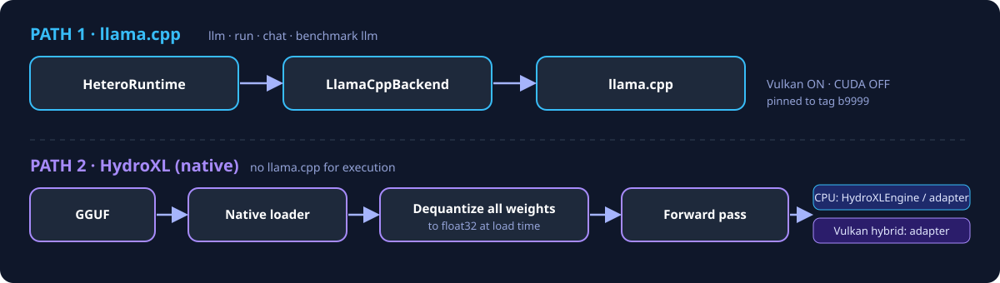
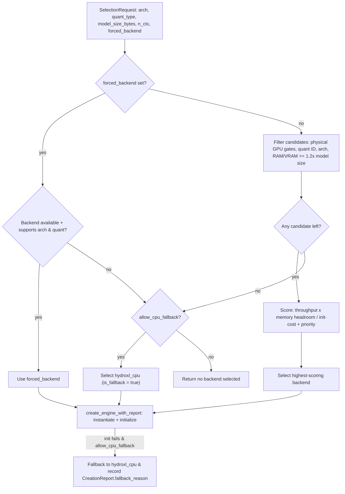

<div align="center">



<br>

**Detect the machine, partition the workload across cooperating engines, validate every capability, and fuse verified results safely.**


[Why](#-why-heteroaccel) · [Status](#-status-at-a-glance) · [Architecture](#-architecture) · [Collaboration](#-collaborative-multi-engine-runtime-phases-3132) · [Models & Quants](#-supported-architectures--quantization-types) · [Phases](#-phase-progress) · [Build](#-platform-build-instructions) · [Usage & Examples](#-usage--sdk-examples) · [Benchmarks](#-performance--reproducible-benchmarks) · [Testing](#-testing) · [Limitations](#-known-limitations) · [Layout](#-repository-layout) · [Developer guide](#-developer-guide) · [Troubleshooting](#-troubleshooting)

</div>

HeteroAccel is a unified, hardware-adaptive, collaborative multi-engine inference runtime. It inspects CPU, system RAM, physical vs. software Vulkan ICDs, and NVIDIA CUDA driver capabilities; analyzes GGUF model architecture, quantization, and memory requirements; and orchestrates **HydroXL** (native dependency-free engine), **llama.cpp** (high-throughput quantized CPU/Vulkan/CUDA engine), and **Colibri** (deterministic structural, complexity, and cross-engine verification analyzer) either individually or as a cooperating DAG pipeline with intermediate-result exchange, memory-constrained model eviction, and evidence-weighted result fusion.



> [!IMPORTANT]
> **Hardware validation scope (`Physically validated` vs. `Runtime-tested` vs. `CI-tested` vs. `Build-tested` vs. `Blocked / Unevidenced`).** Every feature documented below is backed by source code and automated CTest targets (`137/137` passing with zero skips). Physical hardware validation and end-to-end benchmarks in this repository were measured on **12th Gen Intel Core i5-1235U (10C/12T) + Intel Iris Xe Graphics (Vulkan 1.3.250, 16 GB RAM, Windows 11)**. CUDA runtime driver probing, memory management (`cuMemAlloc_v2` / `cuMemcpyHtoD_v2` / `cuMemcpyDtoH_v2`), `GGML_CUDA` compilation (verified on Linux CI with CUDA Toolkit 12.6), and automatic CUDA-to-CPU fallback are `Implemented` + `Build-tested` + `Runtime-tested` (fallback/absence); physical NVIDIA GPU inference execution is **`Blocked / Unevidenced`** on this host because no NVIDIA GPU is installed (documented in [docs/PHASE_33_EVALUATION_REPORT.md](docs/PHASE_33_EVALUATION_REPORT.md), [docs/PHASE_32_FINAL_ENGINEERING_REPORT.md](docs/PHASE_32_FINAL_ENGINEERING_REPORT.md), and [docs/RELEASE_VALIDATION_REPORT.md](docs/RELEASE_VALIDATION_REPORT.md)).

## 📑 Contents

[Why HeteroAccel](#-why-heteroaccel) · [Status at a glance](#-status-at-a-glance) · [Architecture](#-architecture) · [Collaborative Multi-Engine Runtime](#-collaborative-multi-engine-runtime-phases-3132) · [Supported architectures & quantization types](#-supported-architectures--quantization-types) · [Phase progress](#-phase-progress) · [Platform build instructions](#-platform-build-instructions) · [Usage & SDK examples](#-usage--sdk-examples) · [Automatic backend selection & fallback](#-automatic-backend-selection--fallback) · [Performance & reproducible benchmarks](#-performance--reproducible-benchmarks) · [Testing](#-testing) · [Known limitations](#-known-limitations) · [Repository layout](#-repository-layout) · [Developer guide](#-developer-guide) · [Troubleshooting](#-troubleshooting) · [Contributing](#-contributing)

---

## 🎯 Why HeteroAccel

Calling a single inference engine directly assumes the model fits, the backend works, the hardware is what you expect, and probabilistic token generation alone is sufficient for structural and algorithmic accuracy. HeteroAccel adds hardware verification, capability filtering, multi-engine workload partitioning, deterministic structural verification, and safe fallback in front of that call:

| Problem | What HeteroAccel does |
|---|---|
| ❓ "Will this model run here?" | `analyze`, `plan`, and `ha_model_memory_estimate` inspect the GGUF header/tensors and detected hardware before loading weights. |
| 🤝 Single-engine blind spots | `CollaborativeExecutionOrchestrator` decomposes complex queries into DAG waves across **HydroXL** (semantic framing), **llama.cpp** (deep quantized generation), and **Colibri** (deterministic AST/loop complexity & cross-engine verification), exchanging intermediate outputs and fusing validated findings via `ResultFusionEngine`. |
| 🔌 Backend detected ≠ backend usable | Backends declare supported GGML quantization IDs, architecture families, physical-GPU gates, and minimum RAM/VRAM; software Vulkan rasterizers (`llvmpipe`, `lavapipe`, `SwiftShader`) are explicitly flagged as `is_software = true` so they are never mistaken for physical GPU acceleration. |
| 💾 Limited RAM / VRAM | `CollaborativeResourceManager` measures real OS process RSS / Peak RSS (`GetProcessMemoryInfo` / `/proc/self/status` / `mach_task_basic_info`), tracks per-engine memory budgets, and automatically serializes waves with model eviction (`MemoryConstrainedSwap`) when concurrent engines would exceed the RAM budget. |
| 🛟 Backend fails at runtime | `EngineOrchestrator::create_engine_with_report` captures initialization failures and automatically falls back to `hydroxl_cpu`, recording `attempted_backend`, `selected_backend`, `fallback_occurred`, and `fallback_reason`. |
| 🌐 Streaming UTF-8 corruption | `HydroXLTokenizer::decodeTokenStreaming` buffers incomplete multibyte UTF-8 sequences split across BPE tokens so streaming callbacks never emit premature replacement characters (`U+FFFD`) or broken UTF-8 bytes across English, Devanagari/Hindi, emoji, math, and code. |

---

## 🚦 Status at a glance

| Engine / Subsystem | Backend | Validation Classification | Verified Environment & Notes |
|---|---|---|---|
| **HydroXL** *(Native Engine)* | CPU (`hydroxl_cpu`) | **`PHYSICALLY HARDWARE-VALIDATED`** | Multi-threaded row-parallel `matvec` across 7 architectures and 13 GGML quant types; UTF-8 byte-level BPE streaming verified on Intel Core i5-1235U (`Qwen2.5-0.5B-Instruct-Q4_K_M.gguf`). |
| **HydroXL** *(Native Engine)* | Vulkan (`hydroxl_vulkan`) | **`PHYSICALLY HARDWARE-VALIDATED`** | SPIR-V compute shaders (`matvec`, `rmsnorm`, `swiglu`) verified on Intel Iris Xe Graphics (Vulkan 1.3.250); 100% greedy token match with `hydroxl_cpu` (`test_p22_vulkan_engine`). Supports `F32`, `F16`, `Q5_1`, `Q8_0` (`test_p32_release_validation`). |
| **llama.cpp** *(Compatibility Engine)* | CPU (`llamacpp_cpu`) | **`PHYSICALLY HARDWARE-VALIDATED`** | Verified via `LlamaCppEngineAdapter`, `llm --cpu`, `run`, `chat`, and collaborative execution on Intel Core i5-1235U (`21.00–27.01 tok/s` decode). |
| **llama.cpp** *(Compatibility Engine)* | Vulkan (`llamacpp_vulkan`) | **`PHYSICALLY HARDWARE-VALIDATED`** | Built with `HETEROACCEL_ENABLE_VULKAN=ON` (`GGML_VULKAN=ON`). Verified on Intel Iris Xe (`31.34 tok/s` standalone decode; concurrent GPU offload in Wave 0 alongside `HydroXL` on CPU). |
| **llama.cpp** *(Compatibility Engine)* | CUDA (`cuda`) | **`COMPILE-TESTED` + `SOFTWARE-TESTED`** *(Pending Physical NVIDIA GPU)* | `-DHETEROACCEL_ENABLE_CUDA=ON` enables `GGML_CUDA`, `CudaRuntime` driver API, `CUDAAllocator`, and `LlamaCppEngineAdapter` (`cuda`). Compiled with `nvcc` 12.6 in Linux CI (`build-linux-cuda`); driver-absence safety and CPU fallback verified in `test_p26_*` & `test_p32_release_validation`. |
| **Colibri** *(Specialized Analyzer)* | CPU (`colibri_cpu`) | **`PHYSICALLY HARDWARE-VALIDATED`** | Deterministic AST/loop nesting depth (`O(1)`–`O(N^k)`), concurrency hazard analysis, balanced delimiter verification, GGUF metadata inspection, and intermediate-output verification (`<200 ms`). |
| **Collaborative Runtime** | Multi-Engine DAG (`HydroXL` + `llama.cpp` + `Colibri`) | **`PHYSICALLY HARDWARE-VALIDATED`** | `QueryUnderstandingEngine`, `WorkloadPartitioner`, `CollaborativeExecutionOrchestrator`, `CollaborativeResourceManager`, and `ResultFusionEngine` verified end-to-end via CLI, C API, and C++ SDK. |

---

## 🏗️ Architecture



### 🔀 Inference & Collaboration Paths



1. **HydroXL Native Path (`hydroxl_cpu`, `hydroxl_vulkan`)**:
   - Dependency-free GGUF v2/v3 parser, reference-validated dequantizer for 13 GGML tensor types, GPT-2 byte-level BPE and SentencePiece tokenizer with UTF-8 streaming sequence buffering (`decodeTokenStreaming`), GQA KV-cache, and configurable architecture forward pass.
   - **CPU (`hydroxl_cpu`)**: Persistent worker thread pool (`HydroXLOps`) executing 4-way unrolled row-parallel `matvec`.
   - **Vulkan (`hydroxl_vulkan`)**: Uploads dequantized f32 weights to device-local buffers and dispatches `hydroxl_matvec.comp`, `hydroxl_rmsnorm.comp`, and `hydroxl_elemwise.comp` on the GPU while running RoPE and causal GQA attention on the host.
2. **llama.cpp Engine Path (`llamacpp_vulkan`, `llamacpp_cpu`, `cuda`, `llm`, `run`, `chat`)**:
   - Drives `llama.cpp` directly with native quantized block kernels (`Q4_K_M`, `Q2_K`, `Q6_K`, etc.), supporting full GPU layer offloading (`n_gpu_layers = 99`) on Vulkan (`GGML_VULKAN`) or NVIDIA CUDA (`GGML_CUDA`), as well as long-context (`> 2048` tokens) execution.
3. **Colibri Specialized Path (`colibri_cpu`)**:
   - Deterministic (< 1 MB overhead, sub-200 ms) structural analyzer that parses single-line and multi-line braced/braceless loop nesting depth (`O(1)`, `O(N)`, `O(N^2)`, `O(N^3)`), detects synchronization primitives (`std::mutex`, `atomic`, lock-free hazards), verifies balanced delimiters, inspects GGUF tensor/GQA ratios, and cross-validates intermediate outputs emitted by `HydroXL` and `llama.cpp`.

---

## 🤝 Collaborative Multi-Engine Runtime (Phases 31–32)

HeteroAccel does not blindly run all three engines on every prompt, nor does it merely pick one engine and ignore the others on complex analytical tasks:

| Query Category | Selected Engines | Execution Topology | Why |
|---|---|---|---|
| `SIMPLE_FACTUAL_QA` *(e.g. `"What is the capital of France?"`)* | `HydroXL` (`1` task, `1` wave) | Single-engine fast path (`~2.8–3.7 s`) | Short factual prompt with no code or structural verification requirements; `llama.cpp` and `Colibri` are explicitly recorded in `rejected_candidates` to avoid unnecessary startup overhead. |
| `MODEL_METADATA_INSPECTION` *(e.g. `"Inspect GGUF metadata and GQA head ratio"`)* | `Colibri` (`1` task, `1` wave) | Single-engine deterministic path (`~85–119 ms`, `82 MB` RSS) | Pure GGUF header/tensor structural inspection requires zero neural weight loading. |
| `STATIC_COMPLEXITY_ONLY` *(e.g. `"Static loop nesting depth only: ..."`)* | `Colibri` (`1` task, `1` wave) | Single-engine deterministic path (`< 50 ms`) | Deterministic AST/token loop analysis without LLM generation. |
| `CODE_GENERATION_AND_COMPLEXITY` / `ALGORITHMIC_DESIGN_AND_VERIFICATION` / `HYBRID_REASONING_AND_STRUCTURAL_VALIDATION` | `HydroXL` + `llama.cpp` + `Colibri` (`3` tasks, `2` waves) | **Wave 0 (Parallel):** `HydroXL` (`CPU`) + `llama.cpp` (`Vulkan GPU`)<br>**Wave 1 (Dependent):** `Colibri` (`CPU`) | `HydroXL` and `llama.cpp` execute concurrently across heterogeneous devices (CPU + Vulkan GPU); their intermediate outputs (`233+ bytes`) flow into `Colibri` in Wave 1 for structural & algorithmic verification before `ResultFusionEngine` fuses all three outputs. |

### Evidence-Weighted Fusion & Anti-Majority-Voting Guarantee

`ResultFusionEngine` enforces deterministic structural precedence over probabilistic neural agreement:
- **Sanitization:** NaN, negative, or `> 1.0` confidence scores are clamped to `[0.0, 1.0]`; empty, malformed, unvalidated, or repetitive loop outputs are filtered out and flagged in `validation_warnings`.
- **Contradiction Detection & Structural Precedence:** If both neural engines (`HydroXL` and `llama.cpp`) claim `O(N)` linear complexity for a triply-nested loop while `Colibri` proves `O(N^3)` (`max_loop_nesting_depth = 3`), `ResultFusionEngine` logs the contradiction warning and ranks `Colibri`'s verified structural proof **above** the 2-vs-1 neural majority.

---

## 🧬 Supported Architectures & Quantization Types

Full specifications and test coverage are documented in [docs/SUPPORTED_MODELS_AND_QUANTS.md](docs/SUPPORTED_MODELS_AND_QUANTS.md).

### Supported Model Architectures (HydroXL & Orchestrator)

| Architecture String | Model Family | Normalization | Attention & RoPE | FFN Activation | Final Logit Softcapping |
|---|---|---|---|---|---|
| `llama` | LLaMA / LLaMA 2 / LLaMA 3 | Standard RMSNorm | GQA, Normal RoPE ($\theta = 10000$ or $500000$), optional RoPE scaling | SwiGLU (`ffn_gate` + `ffn_up`) | None |
| `mistral`, `mistral3` | Mistral 7B / Mistral-3 | Standard RMSNorm | GQA, Normal RoPE | SwiGLU | None |
| `qwen2` | Qwen2 / Qwen2.5 | Standard RMSNorm | GQA + QKV biases (`attn_q/k/v.bias`), NeoX half-split RoPE ($\theta = 10^6$) | SwiGLU | None |
| `phi3` | Phi-3 Mini / Medium | Standard RMSNorm | Combined `attn_qkv.weight` (split into Q/K/V) or separate Q/K/V, NeoX RoPE | Combined `ffn_up` `[2*n_ff, n_embd]` or separate `ffn_gate` + `ffn_up` | None |
| `gemma` | Gemma 1 | Gemma `(1 + w)` RMSNorm + $\sqrt{d_{\text{model}}}$ embedding scale | GQA, NeoX RoPE | GeGLU (tanh-approximated GELU gate) | None |
| `gemma2` | Gemma 2 | Gemma `(1 + w)` RMSNorm + post-attention & post-FFN norms + $\sqrt{d_{\text{model}}}$ scale | GQA, Attention logit softcapping (`attn_logit_softcapping`) | GeGLU | `final_logit_softcapping` ($\tanh(\text{logit}/cap) \cdot cap$) |

### Supported GGML Quantization Types (13 Reference-Validated Formats)

Every quantization type listed below is decoded by `HydroXLDequant` and verified against upstream GGML reference implementations in `test_p19_dequant_ref` and `test_p27_quant_decoders`:

| GGML Type ID | Name | Block Size | Bytes / Block | Layout Summary | Status |
|---|---|---|---|---|---|
| `0` | `F32` | 1 | 4 | IEEE-754 float32 | ✅ Verified |
| `1` | `F16` | 1 | 2 | IEEE-754 float16 | ✅ Verified |
| `2` | `Q4_0` | 32 | 18 | `fp16 d` + 16 bytes 4-bit unsigned (`q - 8`) | ✅ Verified |
| `3` | `Q4_1` | 32 | 20 | `fp16 d`, `fp16 m` + 16 bytes 4-bit unsigned (`d*q + m`) | ✅ Verified |
| `6` | `Q5_0` | 32 | 22 | `fp16 d`, 4-byte high bits `qh`, 16 bytes low nibbles (`q - 16`) | ✅ Verified |
| `7` | `Q5_1` | 32 | 24 | `fp16 d`, `fp16 m`, 4-byte `qh`, 16 bytes low nibbles (`d*q + m`) | ✅ Verified |
| `8` | `Q8_0` | 32 | 34 | `fp16 d` + 32 `int8_t` values (`d * qs[i]`) | ✅ Verified |
| `10` | `Q2_K` | 256 | 84 | 16 bytes scales/mins + 64 bytes 2-bit quants + `fp16 d`, `fp16 dmin` | ✅ Verified |
| `11` | `Q3_K` | 256 | 110 | 32 bytes `hmask` + 64 bytes `qs` + 12 bytes packed 6-bit scales + `fp16 d` | ✅ Verified |
| `12` | `Q4_K` | 256 | 144 | `fp16 d`, `fp16 dmin` + 12 bytes packed 6-bit scales/mins + 128 bytes 4-bit quants | ✅ Verified |
| `13` | `Q5_K` | 256 | 176 | `fp16 d`, `fp16 dmin` + 12 bytes scales/mins + 32 bytes `qh` + 128 bytes `qs` | ✅ Verified |
| `14` | `Q6_K` | 256 | 210 | 128 bytes `ql` + 64 bytes `qh` + 16 `int8` scales + `fp16 d` | ✅ Verified |
| `15` | `Q8_K` | 256 | 292 | `float d` + 256 `int8` `qs` + 16 `int16` `bsums` | ✅ Verified |

---

## 🗺️ Phase progress

| Phase | Capability | Status | Notes |
|---|---|---|---|
| 1–2 | Hardware detection; Vulkan compute backend (vector add) | ✅ Implemented | Verified on Intel Iris Xe; logs in [phase2_verification_logs/](phase2_verification_logs/). |
| 3 | llama.cpp integration with Vulkan offload | ✅ Implemented | See [docs/phase3-setup.md](docs/phase3-setup.md). |
| 4 | Unified memory manager; automatic backend selection | ✅ Implemented | Includes real CUDA Driver API allocator (`CUDAAllocator`) added in Phase 26. |
| 5 | Adaptive heterogeneous scheduler, cost model | ✅ Implemented | Multi-backend scheduling and cost estimation. |
| 6 | Model/layer manager, streaming, prefetch | ✅ Implemented | Layer residency and prefetching. |
| 7 | `HeteroRuntime`, `run`, `chat` | ✅ Implemented | Interactive and batch inference via llama.cpp (`--collaborate` flag supported). |
| 8–10 | Profiling, performance history, execution policies, hardening | ✅ Implemented | Auto-tuning and fault tolerance. |
| 11–15 | Engine registry, GGUF inspector, execution planner, residency, DAG graph | ✅ Implemented | `analyze`, `plan`, `residency`, `graph` CLI commands. |
| 16–20 | Native tensor primitives, HydroXL engine, plugin ABI, dequantization, optimizations | ✅ Implemented | Tied embeddings, zero hot-path allocations, multi-threaded dequant. |
| 21–22 | Hardware-aware orchestration & HydroXL Vulkan execution | ✅ Implemented | `EngineOrchestrator` + `VulkanTensorOps` SPIR-V compute pipeline. |
| 23 | Stable public C API and C++ RAII SDK | ✅ Implemented | `heteroaccel.h`, `HeteroAccel.hpp`, `libheteroaccel` shared/static targets. |
| 24 | Native token streaming, cancellation, MemoryEstimator, Python bindings, packaging | ✅ Implemented | `ha_infer_stream`, `ha_session_cancel`, `HeteroAccelConfig.cmake`, `heteroaccel.pc`. |
| 25 | Release readiness (`adaptive-gpu infer`, MIT `LICENSE`) | ✅ Implemented | CLI orchestration command and license verification. |
| 26 | Real NVIDIA CUDA backend & Driver API memory runtime | ✅ Implemented | `HETEROACCEL_ENABLE_CUDA`, `CudaRuntime`, `CUDAAllocator`, `LlamaCppEngineAdapter`, CPU fallback (`test_p26_*`). |
| 27 | HydroXL universal model architectures & 13 GGML quant decoders | ✅ Implemented | LLaMA, Mistral, Qwen2, Phi-3, Gemma 1/2 + Q4_0–Q8_K decoders (`test_p27_*`). |
| 28 | Cross-platform portability & software-Vulkan classification | ✅ Implemented | Windows/Linux/macOS portability, `DynamicLibrary`, `llvmpipe` detection, GitHub Actions CI (`test_p28_*`). |
| 29 | End-to-end benchmarking harness & HydroXL thread-pool `matvec` | ✅ Implemented | `heteroaccel-bench`, 4.36x HydroXL CPU speedup (1.56 → 6.80 tok/s), regression gates (`test_p29_*`). |
| 30 | Documentation audit, version `0.30.0` sync, release validation report | ✅ Implemented | Release validation report in [docs/RELEASE_VALIDATION_REPORT.md](docs/RELEASE_VALIDATION_REPORT.md). |
| 31 | Unified Collaborative Multi-Engine Runtime (`HydroXL` + `llama.cpp` + `Colibri`) | ✅ Implemented | `ColibriEngine`, `QueryUnderstandingEngine`, `WorkloadPartitioner`, `CollaborativeExecutionOrchestrator`, `ResultFusionEngine` (`test_p31_*`). |
| 32 | Final cross-validation, UTF-8 streaming stabilization, OS RSS telemetry & release | ✅ Implemented | Streaming UTF-8 codepoint buffer, single-line nested loop parser, selective 1-engine fast paths, anti-majority-vote fusion, 136/136 tests (`test_p32_release_validation`), [docs/PHASE_32_FINAL_ENGINEERING_REPORT.md](docs/PHASE_32_FINAL_ENGINEERING_REPORT.md). |
| 33 | Response quality, generation budgets, prompt isolation & optional Colibri verification | Implemented + Build-tested + Runtime-tested | Central `GenerationBudget` task profiles, versioned `PromptRegistry` (`<data>` delimiting & control-token sanitization), optional `ColibriVerifier` abstention/relevance gate, evidence-driven fusion, constrained Python + semantic eval (`test_p33_response_quality`), 137/137 tests, [docs/PHASE_33_EVALUATION_REPORT.md](docs/PHASE_33_EVALUATION_REPORT.md). |

---

## 🚀 Platform Build Instructions

### Prerequisites

| Requirement | Needed for |
|---|---|
| **C++17 compiler** | MSVC 2022/2026 (Windows), GCC 11+ or Clang 14+ (Ubuntu Linux), AppleClang 15+ (macOS). |
| **CMake ≥ 3.20** | All platforms. |
| **Git** | First CMake configure fetches `llama.cpp` via `FetchContent` (subsequent configures can pass `-DFETCHCONTENT_UPDATES_DISCONNECTED=ON`). |
| **Vulkan SDK** *(optional)* | Required when `HETEROACCEL_ENABLE_VULKAN=ON` (default) for Vulkan headers, loader, and `glslc`/`glslangValidator` shader compilation. When absent or `-DHETEROACCEL_ENABLE_VULKAN=OFF`, the build cleanly produces a CPU-only runtime. |
| **NVIDIA CUDA Toolkit 12.x** *(optional)* | Required only when `-DHETEROACCEL_ENABLE_CUDA=ON`. Compiles `ggml-cuda` kernels and enables the `cuda` backend in `EngineOrchestrator`. |

### 1. Windows 10/11 (MSVC)

```powershell
git clone https://github.com/Deep455-16/HeteroAccel.git
cd HeteroAccel

# Default build (CPU + Vulkan if Vulkan SDK is installed)
cmake -S . -B build -A x64 -DHETEROACCEL_ENABLE_VULKAN=ON -DHETEROACCEL_ENABLE_CUDA=OFF
cmake --build build --config Release

# CPU-only build (no GPU SDKs required)
cmake -S . -B build-cpu -A x64 -DHETEROACCEL_ENABLE_VULKAN=OFF -DHETEROACCEL_ENABLE_CUDA=OFF
cmake --build build-cpu --config Release

# CUDA-enabled build (requires NVIDIA CUDA Toolkit 12.x + nvcc)
cmake -S . -B build-cuda -A x64 -DHETEROACCEL_ENABLE_VULKAN=ON -DHETEROACCEL_ENABLE_CUDA=ON -DHETEROACCEL_CUDA_ARCHITECTURES="75;86;89"
cmake --build build-cuda --config Release
```

### 2. Ubuntu Linux (GCC / Clang)

```bash
# Install dependencies (Ubuntu 22.04 / 24.04)
sudo apt-get update
sudo apt-get install -y build-essential cmake ninja-build libvulkan-dev vulkan-tools glslang-tools

# CPU + Vulkan build
cmake -S . -B build -G Ninja -DCMAKE_BUILD_TYPE=Release \
  -DHETEROACCEL_ENABLE_VULKAN=ON -DHETEROACCEL_ENABLE_CUDA=OFF
cmake --build build --parallel

# CUDA-enabled build (with CUDA Toolkit installed in /usr/local/cuda)
cmake -S . -B build-cuda -G Ninja -DCMAKE_BUILD_TYPE=Release \
  -DHETEROACCEL_ENABLE_VULKAN=OFF -DHETEROACCEL_ENABLE_CUDA=ON \
  -DCMAKE_CUDA_COMPILER=/usr/local/cuda/bin/nvcc \
  -DHETEROACCEL_CUDA_ARCHITECTURES="75;86;89"
cmake --build build-cuda --parallel
```

### 3. macOS (Apple Silicon / Intel)

```bash
# CPU-only portable build
cmake -S . -B build -G Ninja -DCMAKE_BUILD_TYPE=Release \
  -DHETEROACCEL_ENABLE_VULKAN=OFF -DHETEROACCEL_ENABLE_CUDA=OFF
cmake --build build --parallel
```

### Installation & CMake Package Verification

```powershell
cmake --install build --config Release --prefix build/install_verify
```

Installs `include/heteroaccel/heteroaccel.h`, `include/heteroaccel/HeteroAccel.hpp`, shared/static `heteroaccel` libraries, `lib/cmake/HeteroAccel/HeteroAccelConfig.cmake`, and `lib/pkgconfig/heteroaccel.pc`.

---

## 💻 Usage & SDK Examples

Set `HETEROACCEL_MODEL_PATH` to point to a local GGUF model:

```powershell
$env:HETEROACCEL_MODEL_PATH = "D:\HeteroAccel\Models\Qwen2.5-0.5B-Instruct-Q4_K_M.gguf"
$exe = ".\build\Release\adaptive-gpu.exe"
```

### Hardware Detection & Model Inspection

```powershell
& $exe hardware                    # CPU, RAM, physical vs software Vulkan, and CUDA driver probe
& $exe hardware --json             # Machine-readable hardware report
& $exe analyze $env:HETEROACCEL_MODEL_PATH
& $exe plan    $env:HETEROACCEL_MODEL_PATH
```

### Multi-Engine Collaborative CLI (`collaborate`, `run --collaborate`, `chat --collaborate`)

```powershell
# 1. Parallel 3-engine collaboration (Wave 0: HydroXL on CPU + llama.cpp on Vulkan GPU; Wave 1: Colibri on CPU)
& $exe collaborate --model $env:HETEROACCEL_MODEL_PATH `
  --prompt "Analyze the time complexity of: void process(int n) { for (int i = 0; i < n; ++i) for (int j = 0; j < n; ++j) for (int k = 0; k < n; ++k) {} } and propose an optimization." `
  --max-tokens 24 --telemetry

# 2. Memory-constrained collaboration (enforces model eviction & swap to cap Peak RSS)
& $exe collaborate --model $env:HETEROACCEL_MODEL_PATH `
  --prompt "Analyze the time complexity of: void process(int n) { for (int i = 0; i < n; ++i) for (int j = 0; j < n; ++j) for (int k = 0; k < n; ++k) {} } and propose an optimization." `
  --max-tokens 24 --memory-budget-mb 2500 --telemetry

# 3. Selective single-engine routing via collaborate (fast factual Q&A or metadata inspection)
& $exe collaborate --model $env:HETEROACCEL_MODEL_PATH --prompt "What is the capital of France?" --max-tokens 16 --telemetry
& $exe collaborate --model $env:HETEROACCEL_MODEL_PATH --prompt "Inspect GGUF metadata and GQA head ratio of this model." --telemetry

# 4. Collaborative mode in run and interactive chat
& $exe run  $env:HETEROACCEL_MODEL_PATH "Analyze complexity of: for(int i=0;i<n;++i) for(int j=0;j<n;++j) {}" --collaborate --max-tokens 16
& $exe chat $env:HETEROACCEL_MODEL_PATH --collaborate --max-tokens 16
```

### Single-Engine CLI (`infer`, `hydroxl`, `llm`)

```powershell
# 1. Orchestrated inference (auto-selects best available backend with CPU fallback)
& $exe infer --model $env:HETEROACCEL_MODEL_PATH --prompt "The capital of France is" --max-tokens 16

# 2. Force CPU, Vulkan, or CUDA backend explicitly through the orchestrator
& $exe infer --model $env:HETEROACCEL_MODEL_PATH --backend hydroxl_cpu     --prompt "The capital of France is" --max-tokens 16
& $exe infer --model $env:HETEROACCEL_MODEL_PATH --backend hydroxl_vulkan  --prompt "The capital of France is" --max-tokens 16
& $exe infer --model $env:HETEROACCEL_MODEL_PATH --backend llamacpp_vulkan --prompt "The capital of France is" --max-tokens 16
& $exe infer --model $env:HETEROACCEL_MODEL_PATH --backend cuda            --prompt "The capital of France is" --max-tokens 16

# 3. Direct HydroXL native CPU CLI & llama.cpp CLI
& $exe hydroxl --model $env:HETEROACCEL_MODEL_PATH --prompt "The capital of France is" --max-tokens 16 --temperature 0
& $exe llm     --model $env:HETEROACCEL_MODEL_PATH --gpu-layers 99 --prompt "What is an integrated GPU?" --max-tokens 64
```

### Public C SDK Example (`ha_infer` & `ha_collaborate`)

```c
#include <heteroaccel/heteroaccel.h>
#include <stdio.h>

int main(void) {
    printf("HeteroAccel v%s\n", ha_version_string());
    HaRuntime rt = ha_runtime_create();

    HaError err = HA_OK;
    HaModel model = ha_model_load(rt, "Qwen2.5-0.5B-Instruct-Q4_K_M.gguf", &err);
    HaSession session = ha_session_create(model, &err);

    HaCollaborateParams cparams = {0};
    cparams.prompt = "Analyze time complexity: void f(int n) { for(int i=0;i<n;++i) for(int j=0;j<n;++j) {} }";
    cparams.max_new_tokens = 16;
    cparams.temperature = 0.0f;
    cparams.allow_parallel_execution = 1;

    HaCollaborateResult cres = ha_collaborate(session, &cparams);
    if (cres.error == HA_OK) {
        printf("[%s | %d tasks / %d waves | %.1f ms]\n%s\n",
               cres.category_used, cres.tasks_executed, cres.waves_executed,
               cres.total_ms, cres.unified_output);
    }

    ha_collaborate_result_free(&cres);
    ha_session_destroy(session);
    ha_model_unload(model);
    ha_runtime_destroy(rt);
    return 0;
}
```

### Public C++17 RAII SDK Example (`ha::Session::collaborate` & `collaborate_stream`)

```cpp
#include <heteroaccel/HeteroAccel.hpp>
#include <iostream>

int main() {
    ha::Runtime rt;
    ha::Model model = rt.load_model("Qwen2.5-0.5B-Instruct-Q4_K_M.gguf");
    ha::Session session = model.create_session();

    ha::CollaborateParams params;
    params.prompt = "Analyze complexity: void f(int n) { for(int i=0;i<n;++i) for(int j=0;j<n;++j) {} }";
    params.max_new_tokens = 16;
    params.temperature = 0.0f;

    ha::CollaborateResult res = session.collaborate_stream(
        params,
        [](const std::string& engine_id, const std::string& role, const std::string& chunk) {
            std::cout << "[" << engine_id << ":" << role << "] " << chunk << std::flush;
            return true;
        });

    std::cout << "\n--- Telemetry ---\n" << res.telemetry_report << "\n";
    return 0;
}
```

---

## 🧭 Automatic Backend Selection & Fallback



| Backend ID | Engine | Registered When | Priority | Notes |
|---|---|---|---|---|
| `cuda` | `LlamaCppEngineAdapter` (`GGML_CUDA`) | Built with `HETEROACCEL_ENABLE_CUDA=ON` (available when `CudaRuntime` detects >=1 CUDA device with compute capability >= 5.0) | 30 | Falls back cleanly to `hydroxl_cpu` if CUDA init or VRAM allocation fails. |
| `llamacpp_vulkan` | `LlamaCppEngineAdapter` (`GGML_VULKAN`) | Built with `HETEROACCEL_ENABLE_VULKAN=ON` and `HardwareDetector::has_vulkan()` is true | 25 | Supports all 13 GGML quant formats directly on physical Vulkan GPUs without F32 weight expansion. |
| `hydroxl_vulkan` | `HydroXLVulkanEngineAdapter` | `HardwareDetector::has_vulkan()` is true | 20 | Requires a physical Vulkan GPU (`has_physical_vulkan_gpu()`) and supported quant (`F32`, `F16`, `Q5_1`, `Q8_0`). |
| `llamacpp_cpu` | `LlamaCppEngineAdapter` (CPU) | Always | 15 | High-throughput quantized CPU backend supporting long contexts (`> 2048`). |
| `hydroxl_cpu` | `HydroXLCpuEngineAdapter` | Always | 10 | Universal native fallback supporting all 7 architectures and 13 GGML quant formats. |
| `colibri_cpu` | `ColibriEngineAdapter` | Always | 5 | Specialized deterministic structural, complexity, and cross-engine verification engine. |

---

## 📊 Performance & Reproducible Benchmarks

Detailed methodology and optimization analysis are in [docs/BENCHMARKING.md](docs/BENCHMARKING.md) and [docs/PHASE_32_FINAL_ENGINEERING_REPORT.md](docs/PHASE_32_FINAL_ENGINEERING_REPORT.md). Machine-readable benchmark outputs are stored in [`docs/benchmarks/i5_1235u_iris_xe_qwen25_05b_q4km.json`](docs/benchmarks/i5_1235u_iris_xe_qwen25_05b_q4km.json).

### 1. Individual Engine Benchmarks (Intel Core i5-1235U + Intel Iris Xe, `Qwen2.5-0.5B-Instruct-Q4_K_M.gguf`)

| Engine / Backend | Cold Load (ms) | TTFT (ms) | Decode (tok/s) | E2E (tok/s) | Peak RSS (MB) | Effective BW (GB/s) | Validation Status |
|---|---|---|---|---|---|---|---|
| `hydroxl_cpu` *(Phase 28 baseline, single-thread matvec)* | 5232.9 | 3199.6 | 1.56 | 1.19 | 2663.5 | 2.91 | Baseline |
| **`hydroxl_cpu` *(Thread-pool matvec)*** | **1758.5** | **796.9** | **6.80–8.93** | **5.24** | **2662.2** | **12.69** | **`PHYSICALLY HARDWARE-VALIDATED`** |
| `hydroxl_vulkan` *(Intel Iris Xe hybrid GPU/CPU)* | 2691.4 | 1323.1 | 3.74–6.65 | 2.96 | 2536.6 | 6.98 | **`PHYSICALLY HARDWARE-VALIDATED` (`gpu_used: true`)** |
| `llamacpp_cpu` *(llama.cpp b9999 CPU)* | 1087.1 | 190.4 | 21.00–27.01 | 16.87 | 3128.4 | 7.93 | **`PHYSICALLY HARDWARE-VALIDATED`** |
| `llamacpp_vulkan` *(llama.cpp b9999 Intel Iris Xe)* | 1300.9 | 127.0 | 31.34 | 26.78 | 3129.0 | 11.83 | **`PHYSICALLY HARDWARE-VALIDATED` (`gpu_used: true`)** |
| `colibri_cpu` *(Deterministic structural/metadata engine)* | < 1.0 | < 5.0 | Deterministic | N/A (`85–196 ms` total) | 82.0 | N/A | **`PHYSICALLY HARDWARE-VALIDATED`** |

### 2. Collaborative Multi-Engine Benchmarks (`Qwen2.5-0.5B-Instruct-Q4_K_M.gguf`, 24 tokens)

| Collaborative Mode | Active Engines & Backends | Waves / Parallel | Total Time (ms) | HydroXL Time (ms) | llama.cpp Time (ms) | Colibri Time (ms) | Actual RSS (MB) | Peak RSS (MB) | Evictions |
|---|---|---|---|---|---|---|---|---|---|
| **3-Engine Parallel Collaboration** | `HydroXL (CPU)` + `llama.cpp (Vulkan)` + `Colibri (CPU)` | 2 waves (`ConcurrentWave=YES`) | **17,195.60** | 12,204.54 | 16,902.74 | 190.98 | 3,732 | 3,746 | 0 |
| **3-Engine Sequential (`--sequential`)** | `HydroXL (CPU)` → `llama.cpp (Vulkan)` → `Colibri (CPU)` | 3 waves (`ConcurrentWave=NO`) | **27,826.13** | 14,859.10 | 12,741.47 | 181.29 | 3,732 | 3,746 | 0 |
| **3-Engine Memory-Constrained (`--memory-budget-mb 2500`)** | `HydroXL (CPU)` → *evict* → `llama.cpp (Vulkan)` → `Colibri (CPU)` | 3 waves (`MemoryConstrainedSwap=YES`) | **24,906.51** | 12,159.44 | 12,515.34 | 196.62 | **1,244** *(-66.7%)* | **2,601** *(-30.6%)* | **1** |
| **Selective 1-Engine (`SIMPLE_FACTUAL_QA`)** | `HydroXL (CPU)` only | 1 wave (`1` task) | **2,792.11–3,736.33** | 3,662.28 | *Skipped* | *Skipped* | 2,537 | 2,601 | 0 |
| **Selective 1-Engine (`MODEL_METADATA_INSPECTION`)** | `Colibri (CPU)` only | 1 wave (`1` task) | **119.38** | *Skipped* | *Skipped* | 85.20 | **82** | **97** | 0 |

### Historical Phase 20 & Phase 22 Charts


---

## 🧪 Testing

```powershell
# Run the complete 137-test suite in Release mode
ctest --test-dir build -C Release --output-on-failure --parallel 2

# Run Phase 26–33 verification suites
ctest --test-dir build -C Release -R "test_p26|test_p27|test_p28|test_p29|test_p31|test_p32|test_p33" --output-on-failure
```

- **137 automated test targets** registered in `tests/CMakeLists.txt`.
- Latest full-suite verification on Windows 11 (Intel Core i5-1235U + Intel Iris Xe Graphics Vulkan 1.3.250): **`100% tests passed, 0 tests failed, 0 skipped out of 137`** (`Runtime-tested` on Windows CPU+Vulkan; NVIDIA CUDA execution remains `Blocked / Unevidenced` without a physical NVIDIA GPU).
- **Phase 26 (`test_p26_*`)**: CUDA Driver API probing, `CUDAAllocator` allocation/transfer/cleanup, `LlamaCppEngineAdapter` registration, and CUDA-to-CPU fallback.
- **Phase 27 (`test_p27_*`)**: Exact numerical verification for all 13 GGML quantization decoders (`Q4_0` through `Q8_K`, `F16`, `F32`) and synthetic GGUF v3 end-to-end forward-pass tests for `llama`, `mistral`, `qwen2`, `phi3`, `gemma`, and `gemma2`.
- **Phase 28 (`test_p28_*`)**: Cross-platform `DynamicLibrary`, filesystem/threading portability, and software-Vulkan (`llvmpipe`/`lavapipe`/`SwiftShader`) rejection.
- **Phase 29 (`test_p29_*`)**: End-to-end performance regression gates, multi-threaded `matvec` numerical equivalence, and real-model greedy token equivalence between HydroXL and `llama.cpp`.
- **Phase 31 (`test_p31_*`)**: `ColibriEngine` structural & complexity analysis, `WorkloadPartitioner` DAG construction, `CollaborativeResourceManager` contention avoidance, `ResultFusionEngine` synthesis, and `CollaborativeExecutionOrchestrator` end-to-end tests.
- **Phase 32 (`test_p32_release_validation`)**: 20-case UTF-8 & split-multibyte BPE streaming validation, 12-scenario engine-selection & hardware-scheduling matrix, HydroXL Vulkan quantization capability gates, 11 `ResultFusionEngine` edge cases (including 2-vs-1 anti-majority-voting structural precedence), OS RSS telemetry & 5x repeated execution stability, and live 151,936-vocab Qwen2.5 multilingual streaming.
- **Phase 33 (`test_p33_response_quality`)**: `GenerationBudget` task profiles & clamping, versioned `PromptRegistry` (`<data>` delimiting & control-token sanitization), 4-thread request isolation, `HydroXLTokenizer` special/EOG handling, optional `ColibriVerifier` abstention/relevance gate, evidence-driven fusion (no fabricated corroboration + preserved disagreements), negative controls (`max_tokens`, `cancel`, `time_budget`), plus optional live 3-backend semantic + constrained Python evaluation (`docs/PHASE_33_EVALUATION_REPORT.md`).

---

## ⚠️ Known Limitations

1. **CUDA Physical Hardware Execution Pending**:
   - The CUDA backend (`CudaRuntime`, `CUDAAllocator`, `LlamaCppEngineAdapter`, `GGML_CUDA` CMake integration, and CPU fallback) is `COMPILE-TESTED` (Ubuntu CUDA 12.6 CI) and `SOFTWARE-TESTED` on driver-absence/fallback paths. Because the physical validation host has an Intel Iris Xe integrated GPU and no NVIDIA GPU, physical NVIDIA GPU inference execution remains pending an NVIDIA hardware runner.
2. **HydroXL F32 Weight Expansion in RAM**:
   - HydroXL dequantizes model weights to 32-bit floats (`float32`) during model initialization rather than executing fused quantized matrix-vector kernels directly on compressed blocks (~2.54–2.66 GB RSS for a 0.5B model). In collaborative mode under tight memory (`--memory-budget-mb`), `CollaborativeResourceManager` automatically enables `MemoryConstrainedSwap` and evicts `HydroXL`'s F32 weights before loading `llama.cpp`, reducing post-execution RSS to ~1.24 GB.
3. **HydroXL Vulkan Quantization Gate (`F32`, `F16`, `Q5_1`, `Q8_0`)**:
   - `HydroXLVulkanEngineAdapter` explicitly declares support for `F32` (`0`), `F16` (`1`), `Q5_1` (`7`), and `Q8_0` (`8`) in `OrchestratorInit.cpp`. For K-quant models such as `Q4_K_M` (`12`), `CollaborativeResourceManager` and `EngineOrchestrator` automatically route Vulkan GPU execution to `llamacpp_vulkan` and keep `HydroXL` on `hydroxl_cpu`.
4. **HydroXL Vulkan Hybrid Host/Device Transfers**:
   - `HydroXLVulkanEngineAdapter` keeps weights resident in Vulkan `DEVICE_LOCAL` buffers and executes `matvec`, `rmsnorm`, and `swiglu` on the GPU, while activations cross the staging boundary per operation and RoPE/causal attention run on the CPU.
5. **Single-GPU Selection**:
   - `HardwareDetector::best_gpu()` selects the single physical GPU with the largest dedicated VRAM. Multi-GPU tensor parallelism across multiple discrete GPUs is not implemented.

---

## 🗂️ Repository Layout

```text
.
├── CMakeLists.txt            Root build configuration (CPU, Vulkan, CUDA options, FetchContent llama.cpp)
├── include/heteroaccel/      Public C API (heteroaccel.h) and C++17 RAII SDK (HeteroAccel.hpp)
├── src/
│   ├── platform/             Phase 26/28: Cross-platform DynamicLibrary (LoadLibrary / dlopen)
│   ├── cuda/                 Phase 26: CudaRuntime Driver API loader, device probe, HtoD/DtoH transfers
│   ├── hardware/             Phase 1/28: CPU, RAM, DXGI, Vulkan (physical vs software), CUDA detectors
│   ├── gpu/                  Phase 2: VulkanBackend, SPIR-V shader locator, CPU reference
│   ├── llm/ inference/       Phase 3/7: llama.cpp backend wrapper, HeteroRuntime
│   ├── mem/ backend/         Phase 4/26: MemoryManager, CUDAAllocator, BackendSelector
│   ├── scheduler/ profiler/  Phase 5/8/9: AdaptiveScheduler, CostModel, AutoTuner, Profiler
│   ├── model/                Phase 6/14: ModelManager, Residency, StreamingEngine, Prefetch
│   ├── engine/               Phase 11: IExecutionEngine, ExecutionEngineRegistry
│   ├── analysis/ planner/    Phase 12/13: GGUFInspector, CapabilityAnalyzer, ExecutionPlanner
│   ├── execution/            Phase 15: ExecutionGraph and DAG scheduler
│   ├── primitives/           Phase 16: Tensor, HostBuffer, CPU ops
│   ├── hydroxl/              Phase 17–32: GGUF loader, 7 architectures, 13 quant decoders, UTF-8 streaming tokenizer, VulkanTensorOps
│   ├── plugin/               Phase 18/28: Plugin ABI v1 and cross-platform PluginLoader
│   ├── orchestration/        Phase 21–32: EngineOrchestrator, HardwareDetector, HydroXL, LlamaCpp & Colibri adapters
│   ├── colibri/              Phase 31–33: ColibriEngine deterministic structural, complexity & algorithm verification engine
│   ├── collaboration/        Phase 31–33: QueryUnderstandingEngine, WorkloadPartitioner, ColibriVerifier, CollaborativeResourceManager, ResultFusionEngine, CollaborativeExecutionOrchestrator
│   ├── generation/           Phase 33: GenerationBudget, PromptRegistry, SemanticEvaluator
│   ├── sdk/                  Phase 23–33: Public C/C++ SDK implementation (ha_infer, ha_collaborate), MemoryEstimator, PerfProfile
│   ├── benchmark/            Phase 29: EndToEndBench harness and heteroaccel-bench CLI
│   └── cli/main.cpp          adaptive-gpu CLI command dispatcher (Wide-char Windows UTF-8 arg support)
├── examples/                 Public C (c_example.c) and C++ (cpp_example.cpp) consumer examples
├── python/                   Python ctypes bindings (heteroaccel.py) and unit tests
├── shaders/                  GLSL compute shaders compiled to SPIR-V at build time
├── tests/                    137 automated CTest executables (Phases 1–33)
├── docs/                     Architecture notes, benchmark reports, PHASE_32_FINAL_ENGINEERING_REPORT.md, and PHASE_33_EVALUATION_REPORT.md
├── LICENSE                   MIT License
└── Security.md               Security policy and vulnerability reporting
```

---

## 🛠️ Developer Guide

### Add an Inference Backend or Collaborative Engine

1. Implement `IInferenceEngine` (`src/orchestration/IInferenceEngine.h`): `initialize`, `run`, `run_stream`, `shutdown`, `backend_id`, `is_ready`.
2. Populate a `BackendCapabilities` descriptor (`supported_quant_types`, `supported_architectures`, `requires_vulkan`, `requires_cuda`, `min_vram_bytes`, `min_ram_bytes`, `priority`).
3. Register the descriptor and factory in `src/orchestration/OrchestratorInit.cpp` (`register_default_backends`).
4. Add unit and integration tests under `tests/` and register them in `tests/CMakeLists.txt`.

---

## 🩺 Troubleshooting

| Symptom | Likely cause and fix |
|---|---|
| CMake warns "Neither glslangValidator nor glslc was found" | Vulkan SDK `Bin` directory is not on `PATH`. CPU builds still succeed; install the Vulkan SDK if you need `hydroxl_vulkan` shader compilation. |
| `cuda` backend reports `not available on current hardware` | Built without `-DHETEROACCEL_ENABLE_CUDA=ON` or no NVIDIA GPU / `nvcuda.dll` / `libcuda.so.1` driver is present. When `allow_cpu_fallback` is true, `EngineOrchestrator` and `CollaborativeResourceManager` automatically fall back to Vulkan/CPU. |
| CMake reconfigure stalls in offline/sandboxed environments | Pass `-DFETCHCONTENT_UPDATES_DISCONNECTED=ON` after the initial `llama.cpp` clone so CMake does not attempt a network `git fetch`. |
| Software Vulkan adapter (`llvmpipe`) detected on Linux CI | HeteroAccel flags `llvmpipe`/`lavapipe`/`SwiftShader` with `is_software = true` and `has_physical_vulkan_gpu() == false`, preventing slow CPU-emulated Vulkan from outranking native multi-threaded CPU execution. |

---

## 🤝 Contributing

1. Build in Release mode and run `ctest --test-dir build -C Release --output-on-failure` to ensure 100% of tests pass with zero skips.
2. Validate numerical changes against upstream reference implementations (`ggml` for quantization decoders, `llama.cpp` for end-to-end model outputs).
3. Never claim hardware validation or benchmark numbers that were not measured on real hardware.
4. Report security issues privately as described in [Security.md](Security.md).

## 🔗 Links

- Repository: <https://github.com/Deep455-16/HeteroAccel>
- Phase 33 Response Quality & Evaluation Report: [docs/PHASE_33_EVALUATION_REPORT.md](docs/PHASE_33_EVALUATION_REPORT.md)
- Phase 32 Final Engineering & Release Report: [docs/PHASE_32_FINAL_ENGINEERING_REPORT.md](docs/PHASE_32_FINAL_ENGINEERING_REPORT.md)
- Supported Models & Quantizations: [docs/SUPPORTED_MODELS_AND_QUANTS.md](docs/SUPPORTED_MODELS_AND_QUANTS.md)
- Benchmarking Guide: [docs/BENCHMARKING.md](docs/BENCHMARKING.md)
- Release Validation Report (v0.30.0): [docs/RELEASE_VALIDATION_REPORT.md](docs/RELEASE_VALIDATION_REPORT.md)
- Security Policy: [Security.md](Security.md)

<div align="center">

<sub>HeteroAccel v0.32.0 · detect · partition · collaborate · verify · fuse safely</sub>

</div>
