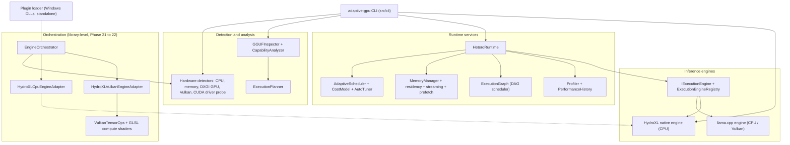
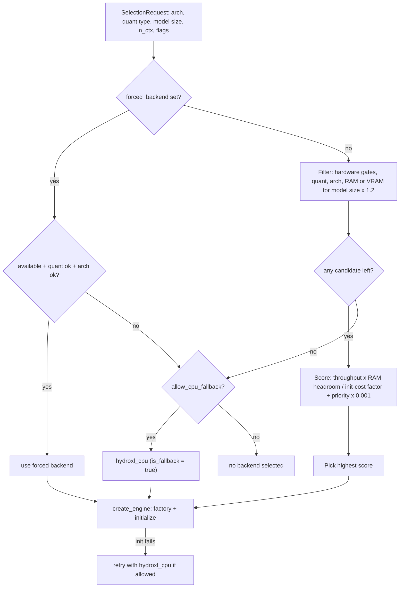

# HeteroAccel

**A hardware-aware inference runtime for local LLMs: detect the machine, check what each backend can actually run, plan the execution, and fall back safely.**


-0078D4)


HeteroAccel is the runtime layer *around* inference engines. It inspects CPU, memory, Vulkan and CUDA capabilities, analyzes a GGUF model's requirements, plans residency and placement, schedules work, and drives either an external engine (llama.cpp) or its own native engine (**HydroXL**).

> **Read this first.** Everything below is derived from the source tree at the latest commit. Results were measured on **one machine** (Intel Core i5-1235U, Intel Iris Xe, 16 GB RAM, Windows). CUDA has never been run and is **not enabled in the current build**. See [Status at a glance](#status-at-a-glance) and [Known limitations](#known-limitations).

## Contents

[Why HeteroAccel](#why-heteroaccel) · [Status at a glance](#status-at-a-glance) · [Architecture](#architecture) · [Phase progress](#phase-progress) · [Quick start](#quick-start) · [Usage](#usage) · [Performance](#performance) · [Testing](#testing) · [Known limitations](#known-limitations) · [Repository layout](#repository-layout) · [Developer guide](#developer-guide) · [Troubleshooting](#troubleshooting) · [Contributing](#contributing)

---

## Why HeteroAccel

Calling an inference engine directly assumes the model fits, the backend works, and the hardware is what you expect. HeteroAccel adds the decisions in front of that call:

| Problem | What HeteroAccel does |
|---|---|
| "Will this model run here?" | `analyze` and `plan` inspect the GGUF and the detected hardware and explain the verdict before anything is loaded. |
| Backend detected ≠ backend usable | Backends declare supported quantization types, architectures and hardware gates; the orchestrator filters on those, not just on "a GPU exists". |
| Limited RAM / VRAM | Memory manager, residency tracking, streaming, prefetch and LRU/priority eviction (Phases 4, 6, 14). |
| Backend fails at runtime | Orchestrator falls back to the CPU engine and reports that it did. |
| Engine lock-in | Engines sit behind `IExecutionEngine` / `IInferenceEngine`; llama.cpp and HydroXL are two implementations. |
| Opaque performance | Profiler and performance history feed the scheduler and orchestrator scoring. |

**HydroXL** is the native engine: its own GGUF parser, dequantizer, BPE tokenizer, KV cache, sampler and transformer forward pass, with an optional Vulkan compute path. It does not link llama.cpp for execution. It is intentionally narrow (see [limitations](#known-limitations)).

## Status at a glance

| Area | Status | Notes |
|---|---|---|
| CPU inference via llama.cpp | Implemented | `llm`, `run`, `chat`. llama.cpp pinned to tag `b9999` via CMake `FetchContent`. |
| Vulkan inference via llama.cpp | Implemented | Built with `GGML_VULKAN=ON`. Tested on Intel Iris Xe only. |
| HydroXL native CPU engine | Implemented | `hydroxl` CLI command. Qwen2 architecture only. |
| HydroXL Vulkan engine | Implemented, **API/test-only** | `HydroXLVulkanEngineAdapter`; hybrid CPU/GPU. No CLI command exposes it. Verified on Iris Xe only. |
| Hardware-aware orchestrator | Implemented, **library-only** | `EngineOrchestrator` is exercised by tests; the CLI does not call it. |
| Plugin loader | Implemented, **Windows-only, not wired** | Native DLL ABI; plugins are not registered as engines and not connected to the orchestrator. |
| CUDA | **Not available in this build** | Detection code exists; no CUDA kernels, no CUDA engine adapter, `GGML_CUDA` forced `OFF`, and the orchestrator's CUDA registration is behind a macro the build never defines. |
| Linux / macOS | **Unverified** | `PluginLoader.cpp` includes `<windows.h>` unconditionally and is part of the default build. |
| AMD / NVIDIA / ARM Vulkan devices | **Untested** | Vendor detection exists; no inference results. |

## Architecture



Solid lines are wired in code. The orchestrator is not reached from the CLI today, and the dotted plugin link marks a **planned** integration, not a working one.

### Two inference paths

1. **llama.cpp path** (`llm`, `run`, `chat`, `benchmark llm`): `HeteroRuntime` → `LlamaCppBackend` → llama.cpp. llama.cpp is built with Vulkan on and CUDA off.
2. **HydroXL path**: GGUF → native loader → dequantize every weight to float32 at load time → native forward pass.
   - **CPU:** `adaptive-gpu hydroxl ...` (via `HydroXLEngine`) or `HydroXLCpuEngineAdapter`.
   - **Vulkan hybrid:** `HydroXLVulkanEngineAdapter`, selectable through `EngineOrchestrator`.

### Hardware detection and capability checks

- **Phase 1 detectors** (`src/hardware`): CPU, memory, GPU (DXGI on Windows), Vulkan, and CUDA. CUDA is probed by loading the NVIDIA driver library at runtime (no CUDA SDK needed); this has not been exercised on NVIDIA hardware. Output: `adaptive-gpu hardware [--json]`.
- **Phase 21 detector** (`src/orchestration/HardwareDetector`): singleton registry of RAM, CPU and every Vulkan device (VRAM from the device-local heap, vendor ID, queue count, driver version), with a DXGI fallback and a mock mode for deterministic tests.
- **Backend capability descriptors** (`BackendCapabilities`): supported GGML quantization IDs, supported architectures, `requires_vulkan` / `requires_cuda`, minimum VRAM/RAM, a heuristic throughput, cold-start cost, and priority. `is_available(hw)` checks the hardware gates.

### Orchestration



`throughput` is the best observed tok/s recorded through `record_performance()` when available, otherwise the descriptor's heuristic. `select_backend()` and `create_engine()` are mutex-protected. Default registrations (`OrchestratorInit.cpp`):

| Backend | Registered when | Heuristic throughput | Init cost | Priority |
|---|---|---|---|---|
| `hydroxl_cpu` | always | 1.0 | 2000 ms | 10 |
| `hydroxl_vulkan` | Vulkan detected | 2.5 (taken from the Iris Xe measurement) | 500 ms | 20 |
| `cuda` | only if built with `HETEROACCEL_CUDA_ENABLED` and CUDA detected | 5.0 (heuristic, never measured) | 3000 ms | 30 |

> The registered quantization and architecture lists are **wider than what HydroXL can load** (see [limitations](#known-limitations)). The orchestrator will not stop you from selecting a backend for a model HydroXL then rejects at load time.

### HydroXL Vulkan execution (Phase 22)

Weights are dequantized on the CPU, uploaded once as float32 device buffers, and reused. Each GPU operation takes **host pointers**: inputs are uploaded and outputs downloaded per call, so activations round-trip between host and device. Only weights stay device-resident.

```mermaid
flowchart LR
    T["token id"] --> E["Embedding lookup (CPU)"]
    E --> N1["RMSNorm (GPU)"]
    N1 --> QKV["Q, K, V matvec (GPU)"]
    QKV --> B["QKV bias add (CPU)"]
    B --> R["RoPE (CPU)"]
    R --> KV["KV cache write (host)"]
    KV --> A["Causal GQA attention (CPU)"]
    A --> O["Output projection (GPU)"]
    O --> R1["Residual add (GPU)"]
    R1 --> N2["RMSNorm (GPU)"]
    N2 --> F["Gate + up matvec, SwiGLU, down matvec (GPU)"]
    F --> R2["Residual add (GPU)"]
    R2 -- "next layer" --> N1
    R2 -- "after last layer" --> FN["Final RMSNorm (GPU)"]
    FN --> LM["LM head matvec (GPU)"]
    LM --> L["logits to sampler (CPU)"]
```



Shaders in `shaders/`, compiled to SPIR-V at build time: `hydroxl_matvec.comp` (one workgroup per output row, 256 threads, shared-memory reduction), `hydroxl_rmsnorm.comp`, `hydroxl_elemwise.comp` (residual add / SiLU / SwiGLU via push constant), `hydroxl_softmax.comp`, plus `vector_add.comp` from Phase 2. Softmax is not called from the Vulkan forward pass (attention runs on the CPU).

### Plugin system

`src/plugin` defines a C-linkage, `__stdcall` DLL ABI (`PluginAbis.h`, ABI version 1) and a host loader with discover / load / execute / unload and ABI-version rejection. Plugins run **in-process with full host privileges and no sandbox**. A loaded plugin is invoked through `plugin_execute()`; it is **not** an `IExecutionEngine`, and the orchestrator does not discover plugins. The build produces two test plugins: `hydroxl_test_plugin` (valid) and `test_plugin_badabi` (negative control). See [docs/phase18-plugin.md](docs/phase18-plugin.md).

## Phase progress

"Implemented" means source exists, tests are registered in `tests/CMakeLists.txt`, and a commit marks the phase. It does **not** mean every scenario was verified on every machine; the Notes column says what is missing.

| Phase | Capability | Status | Notes |
|---|---|---|---|
| 1–2 | Hardware detection; Vulkan compute backend (vector add) | Implemented | Verified on Iris Xe; logs in [phase2_verification_logs/](phase2_verification_logs/). |
| 3 | llama.cpp integration with Vulkan offload | Implemented | See [docs/phase3-setup.md](docs/phase3-setup.md). |
| 4 | Unified memory manager; automatic backend selection | Implemented | CUDA allocator is a stub (returns invalid blocks). |
| 5 | Adaptive heterogeneous scheduler, cost model | Implemented | CUDA worker only runs through a caller-supplied callback. |
| 6 | Model/layer manager, streaming, prefetch | Implemented | |
| 7 | `HeteroRuntime`, `run`, `chat` | Implemented | llama.cpp backend. |
| 8 | Profiling, performance history, auto-tuning | Implemented | |
| 9 | Execution policies, multi-workload scheduling | Implemented | |
| 10 | Production hardening | Implemented | |
| 11 | Universal execution engine interface and registry | Implemented | [docs/architecture.md](docs/architecture.md) |
| 12 | GGUF inspection and capability analysis | Implemented | `analyze` |
| 13 | Execution planner | Implemented | `plan`. `STREAMING` plans are advisory (see [docs/phase13-execution-planner.md](docs/phase13-execution-planner.md)). |
| 14 | Model residency and streaming | Implemented | `residency`. Real-GGUF tests skip without a model. |
| 15 | Heterogeneous execution graph | Implemented | `graph` |
| 16 | Native tensor/buffer primitives | Implemented | Scalar CPU ops only; Vulkan operator library arrived in Phase 22. [docs/phase16-primitives.md](docs/phase16-primitives.md) |
| 17 | HydroXL native engine | Implemented | CPU, scalar float32. [docs/phase17-hydroxl.md](docs/phase17-hydroxl.md) |
| 18–19 | Plugin ABI and loader; dequantization vs. GGML reference; GPT-2 BPE tokenizer | Implemented (Windows) | Plugin not wired to the registry. Q2_K/Q5_K/Q4_0/Q4_1 are parsed but **not** dequantized. [docs/phase19-dequant.md](docs/phase19-dequant.md) |
| 20 | HydroXL optimizations | Implemented | See below. [docs/phase20-improvements.md](docs/phase20-improvements.md) |
| 21 | Hardware-aware orchestration | Implemented (library) | Not called from the CLI. [docs/phase21-universal-orchestration.md](docs/phase21-universal-orchestration.md) |
| 22 | HydroXL Vulkan tensor execution | Implemented (API/test) | Iris Xe only. [docs/phase22-vulkan-execution.md](docs/phase22-vulkan-execution.md) |

**Phase 20** (per its documentation): bounds and 64-bit overflow checks in GGUF/tensor loading; truncated-tensor detection; up-front context-limit rejection; tied LM-head sharing (avoids a ~544.6 MB duplicate for Qwen2.5-0.5B); reused scratch buffers in load, attention and sampling; multi-threaded dequantization via `std::async`; 4-way unrolled float `matvec`. Numbers are in [Performance](#performance).

**Phase 21 / 22:** see [Orchestration](#orchestration) and [HydroXL Vulkan execution](#hydroxl-vulkan-execution-phase-22). `docs/architecture.md` and parts of `docs/phase21-universal-orchestration.md` still describe the Vulkan adapter as a stub; Phase 22 replaced it (the source is authoritative).

## Quick start

### Prerequisites

| Requirement | Needed for |
|---|---|
| Windows 10/11, x64 | The only verified platform. |
| Visual Studio 2022 or 2026 with the Desktop C++ workload (MSVC) | Build. The documented generator is `Visual Studio 18 2026`; any CMake-supported MSVC generator should work but only that one is documented. |
| CMake ≥ 3.20 | Build. |
| Git and internet access | First configure fetches llama.cpp `b9999` (a few minutes; the CMake comment advises ~2 GB free disk). |
| **Vulkan SDK** (loader, headers, `glslangValidator` or `glslc`) | Vulkan detection, Vulkan compute, and compiling the `.comp` shaders. Without it the build succeeds with warnings, Vulkan is stubbed to "unavailable", and shaders are not compiled. A Vulkan-capable GPU driver is needed at runtime. |
| A GGUF model | Anything beyond `hardware`/`devices`/`memory`. The documented test model is `Qwen2.5-0.5B-Instruct-Q4_K_M.gguf`. Models are not in the repository (`*.gguf` is git-ignored). |

**CUDA is not a build prerequisite and is not usable** in the current configuration: `GGML_CUDA` is forced `OFF`, and no CUDA toolkit is referenced by the build. NVIDIA GPUs can still be used through Vulkan, but that is untested.

### Build

```powershell
git clone https://github.com/Deep455-16/HeteroAccel.git
cd HeteroAccel

# Configure (downloads llama.cpp on first run)
cmake -S . -B build -G "Visual Studio 18 2026" -A x64

# Build
cmake --build build --config Release
```

Use a different `-G` if you have another Visual Studio version. Outputs (from `CMakeLists.txt`): `build\Release\adaptive-gpu.exe`, compiled shaders in `build\Release\shaders\`, and test plugins in `build\Release\plugins\`.

If `glslangValidator`/`glslc` is not on `PATH`, `CMakeLists.txt` also looks in `D:/VulkanSDK/1.4.357.0/Bin`, a path specific to the author's machine. Put your Vulkan SDK `Bin` directory on `PATH` (the SDK installer normally does this) and reconfigure.

### Point at a model

```powershell
$env:HETEROACCEL_MODEL_PATH = "C:\models\Qwen2.5-0.5B-Instruct-Q4_K_M.gguf"
```

`llm`, `benchmark llm`, `run` and `chat` read this variable when `--model` is omitted. `hydroxl`, `analyze`, `plan`, `residency` and `graph` take the path as an argument and do not read it. The real-model tests read it too.

## Usage

All examples run from the repository root after a Release build.

```powershell
$exe = ".\build\Release\adaptive-gpu.exe"

& $exe --help                      # command list
& $exe hardware                    # detected CPU / memory / GPU / Vulkan / CUDA
& $exe hardware --json
& $exe devices                     # backend discovery and automatic selection
& $exe memory                      # memory manager statistics
& $exe benchmark vulkan            # CPU vs Vulkan vector-add benchmark
```

### Analyze and plan a model (no inference)

```powershell
$model = "C:\models\Qwen2.5-0.5B-Instruct-Q4_K_M.gguf"
& $exe analyze $model              # Phase 12: requirements vs. detected hardware
& $exe plan $model                 # Phase 13: placement and residency strategy
& $exe residency $model            # Phase 14 residency demo (4 GB RAM budget is hard-coded in the command)
& $exe graph $model                # Phase 15 execution graph, DAG validation
```

An `analyze`/`plan` result describes feasibility. It does not prove the model will execute correctly on a backend.

### Inference through llama.cpp

```powershell
# CPU only
& $exe llm --model $model --cpu --prompt "What is an integrated GPU?" --max-tokens 64

# Vulkan offload (default --gpu-layers is 99 = as many as fit)
& $exe llm --model $model --gpu-layers 99 --prompt "What is an integrated GPU?" --max-tokens 64

# CPU vs Vulkan comparison
& $exe benchmark llm --model $model

# HeteroRuntime-scheduled single run and interactive chat
& $exe run  --model $model --prompt "Explain virtual memory in simple terms." --max-tokens 128
& $exe chat --model $model            # type "exit" or "quit" to leave
```

### Inference through HydroXL (native, CPU)

```powershell
& $exe hydroxl --model $model --prompt "The capital of France is" --max-tokens 16 --temperature 0
```

Flags: `--model/-m`, `--prompt/-p` (default `Hello, world!`), `--max-tokens/-n` (default 128), `--temperature/-t` (default 0.8). The sampling seed is fixed at 42. Output ends with token count, tok/s and backend name. Only `qwen2` GGUFs with the supported weight types load (see [limitations](#known-limitations)).

### HydroXL on Vulkan through the orchestrator (C++ API)

There is no CLI command for this path. The snippet mirrors `tests/test_p21_e2e_orchestration.cpp` and `tests/test_p22_vulkan_engine.cpp`; link against `agr_orchestration` (and its dependencies, as `tests/CMakeLists.txt` does).

```cpp
#include "orchestration/EngineOrchestrator.h"
#include "orchestration/OrchestratorInit.h"
#include "orchestration/HardwareDetector.h"
#include <iostream>

using namespace agr::orchestration;

int main() {
    auto& hw = HardwareDetector::instance();
    hw.detect();

    auto& orch = EngineOrchestrator::instance();
    orch.reset();                           // also installs the two HydroXL engine factories
    register_default_backends(orch, hw);

    EngineOrchestrator::SelectionRequest req;
    req.model_path = "C:\\models\\Qwen2.5-0.5B-Instruct-Q4_K_M.gguf";
    req.model_arch = "qwen2";
    req.quant_type = 12;                    // GGML_TYPE_Q4_K
    req.model_size_bytes = 0;               // set to the file size to enable the RAM/VRAM gates

    auto sel = orch.select_backend(req);
    std::cout << sel.selected_backend << ": " << sel.reason << "\n";

    std::string err;
    auto engine = orch.create_engine(sel, req, err);   // falls back to hydroxl_cpu on init failure
    if (!engine) { std::cerr << err << "\n"; return 1; }

    InferenceRequest ir;
    ir.max_new_tokens = 8;
    ir.temperature = 0.0f;                  // greedy; empty prompt_token_ids => "The capital of France is"
    auto res = engine->run(ir);
    std::cout << res.backend_used << " " << res.tokens_per_second << " tok/s\n";

    orch.record_performance(res.backend_used, res.tokens_per_second, 0);
    engine->shutdown();
}
```

To force a backend, set `req.forced_backend = "hydroxl_vulkan"` (or `"hydroxl_cpu"`). To see candidates and scores, call `orch.print_diagnostics(std::cout)`.

## Performance

Only numbers recorded in the repository's own reports are shown. Nothing here was re-measured for this README.

### Phase 22: CPU vs. Vulkan (HydroXL, single run)

| | |
|---|---|
| System | Intel Core i5-1235U, **Intel Iris Xe** (unified memory), 16 GB RAM |
| Model | Qwen2.5-0.5B-Instruct, Q4_K_M |
| Workload | `test_p22_vulkan_engine`: 8 new tokens, greedy (temperature 0), default prompt "The capital of France is" |

| Backend | tok/s |
|---|---|
| HydroXL CPU | **2.07** |
| HydroXL Vulkan | **5.20** |

The report states the CPU and Vulkan outputs are token-identical for this run (the test asserts it). **This is a workload- and hardware-specific result:** one run, one small model, one integrated GPU, no variance reported, and no raw log committed (the figures live in [docs/phase22-vulkan-execution.md](docs/phase22-vulkan-execution.md)). It says nothing about discrete GPUs, other vendors, larger models, or the llama.cpp path. Reproduce:

```powershell
$env:HETEROACCEL_MODEL_PATH = "C:\models\Qwen2.5-0.5B-Instruct-Q4_K_M.gguf"
ctest --test-dir build -C Release -R test_p22_vulkan_engine -V
```

### Phase 20: HydroXL CPU before/after (same machine, 5 runs)

From [docs/phase20-improvements.md](docs/phase20-improvements.md), Release build, same model:

| Metric | Before | After |
|---|---|---|
| Cold model load | 2,359.82 ms | 1,655.77 ms |
| Prompt throughput (5 tokens) | 1.27 tok/s | 2.71 ± 0.67 tok/s |
| Generation throughput | 1.18 tok/s | 2.48 ± 0.23 tok/s |
| Time to first token | ~3,948 ms | 1,915.76 ± 357.02 ms |
| Peak RSS | ~3,100 MB | 2,561.13 MB |
| Per-token hot-path heap allocations | 26 | 0 |

The Phase 22 CPU figure (2.07 tok/s) comes from a different test and a single run, so it is not directly comparable to the Phase 20 mean (2.48 tok/s).

### Orchestration overhead (Phase 21 report)

`HardwareDetector::detect()` ≈ 1 ms; `select_backend()` < 50 µs; `create_engine()` + initialize ≈ 1,656 ms (model load dominates).

## Testing

```powershell
# Full suite
ctest --test-dir build -C Release --output-on-failure

# By phase
ctest --test-dir build -C Release -R "test_p22" --output-on-failure
ctest --test-dir build -C Release -R "test_p17|test_p19" --output-on-failure
```

- `tests/CMakeLists.txt` registers **105** test executables built on a small header (`tests/mini_test.h`). The count comes from the CMake file, not from a run.
- Tests that need a GPU or a model **skip with exit code 77** (CTest `SKIP_RETURN_CODE`) when Vulkan or `HETEROACCEL_MODEL_PATH` is missing. A skipped test is not a passed test; check the CTest summary for skips. `test_p21_e2e_orchestration` additionally falls back to a hard-coded `D:\HeteroAccel\Models\...` path.
- Dequantization is checked against the real GGML reference (`test_p19_dequant_ref`), not a transcribed copy.
- Vulkan ops are checked against CPU references (`test_p22_vulkan_ops`; reported max differences: matvec 1.19e-06, RMSNorm 2.38e-07, softmax 1.86e-09).

**Last documented results** (all on the Iris Xe machine, from the project docs; not re-run for this README):

| Report | Result |
|---|---|
| Phase 21 | Full regression 103/103 passed (docs/phase21-universal-orchestration.md) |
| Phase 22 | `test_p22_vulkan_ops` and `test_p22_vulkan_engine` reported passing (docs/phase22-vulkan-execution.md) |

A full-suite result for the current commit, which includes the Phase 22 changes, is **not documented**.

## Known limitations

**Platform and hardware**
- Only Windows/MSVC has been used. `PluginLoader.cpp` includes `<windows.h>` unconditionally and is linked into the default build, so Linux/macOS builds are unverified and likely fail as-is.
- Documented performance and tests come from one Intel Iris Xe system. NVIDIA, AMD, ARM and discrete-GPU Vulkan behavior is untested, including the "vendor-neutral" claim in the Phase 22 report.
- **CUDA does not run.** No CUDA engine adapter exists; `CUDAAllocator` returns invalid blocks; `GGML_CUDA` is forced `OFF`; `HETEROACCEL_CUDA_ENABLED` is not defined anywhere in the build, so the orchestrator's `cuda` backend can never register.
- Single-GPU only (`best_gpu()` picks the device with the most VRAM); no multi-GPU or multi-device model splitting.

**HydroXL**
- Architecture: `qwen2` only (the loader rejects others). Tokenizer: GPT-2 byte-level BPE only.
- Weight types that load: F32, F16, Q4_K, Q3_K, Q5_0, Q5_1, Q6_K, Q8_0. Q4_0, Q4_1, Q2_K, Q5_K and others are rejected at load.
- The orchestrator advertises more than this (architectures `llama`, `mistral`, `phi`, `gemma`; quantization IDs such as 2, 10, 13, 15). Treat those lists as aspirational: selection can succeed for a model HydroXL then cannot load. The Phase 22 note that Vulkan "supports all GGUF quantization formats" holds only for formats HydroXL can already dequantize.
- All weights are dequantized to float32 at load: memory is roughly 4× the quantized size (Phase 20 peak RSS 2.56 GB for the 0.5B model on CPU). The Vulkan adapter also keeps the host copy loaded; its peak memory has not been documented.
- Vulkan path is hybrid: embedding, QKV bias, RoPE, KV cache and attention run on the CPU, and activations cross the host/device boundary on every GPU op. Context is capped at `min(model max, 2048)` tokens.
- **Output quality:** the Phase 22 report records garbled / non-English output for the tested model–tokenizer combination, carried over from Phase 19. CPU and Vulkan tokens match, so it is not a Vulkan regression, but generated text should not be assumed correct.

**Integration**
- `EngineOrchestrator` is not called by the CLI; `hydroxl` always uses the CPU engine.
- Plugins are not registered in `ExecutionEngineRegistry` and not connected to the orchestrator; plugin execution is a lifecycle demonstration, not a model runtime.
- Performance history is in-memory per process; the orchestrator does not persist it.
- Streaming (Phase 14) is infrastructure; the Phase 13 `STREAMING` plan strategy is advisory and not an executable path.

**Project**
- No `LICENSE` file is present in the repository at this commit.
- `HeteroAccel-Research/` is a legacy prototype tree that is not part of the build; its README is outdated.

## Repository layout

```text
.
├── CMakeLists.txt            Libraries agr_*, CLI target adaptive-gpu, plugins, tests, shader compilation
├── src/
│   ├── hardware/             Phase 1: CPU, memory, GPU, Vulkan, CUDA-driver detection
│   ├── gpu/                  Phase 2: VulkanBackend, shader locator, CPU reference
│   ├── llm/ inference/       Phase 3/7: llama.cpp adapter, HeteroRuntime
│   ├── mem/ backend/         Phase 4: memory manager, pools, eviction; backend selection
│   ├── scheduler/ profiler/  Phase 5/8/9: scheduler, cost model, auto-tuner, policies, profiler
│   ├── model/                Phase 6/14: layers, residency, streaming, prefetch, GGUF regions
│   ├── engine/               Phase 11: IExecutionEngine, registry, llama.cpp engine
│   ├── analysis/ planner/    Phase 12/13: GGUF inspector, capability analyzer, execution planner
│   ├── execution/            Phase 15: execution graph and scheduler
│   ├── primitives/           Phase 16: Tensor, HostBuffer, CPU ops, IBackendExecutor
│   ├── hydroxl/              Phase 17-22: native engine, dequant, tokenizer, VulkanTensorOps
│   ├── plugin/               Phase 18/19: plugin ABI, SDK header, loader
│   ├── orchestration/        Phase 21/22: orchestrator, hardware registry, engine adapters
│   └── cli/main.cpp          adaptive-gpu command dispatcher
├── shaders/                  GLSL compute shaders (compiled to SPIR-V at build time)
├── tests/                    One executable per test; registered in tests/CMakeLists.txt
├── docs/                     Per-phase design notes and docs/architecture.md
├── phase2_verification_logs/ Phase 2 verification output (UTF-16 text logs)
├── test_plugin.cpp           Source of the sample plugin DLL
├── Security.md               Security policy and reporting
└── HeteroAccel-Research/     Legacy prototype, not built
```

The executable is named `adaptive-gpu` (the project's original name, `AdaptiveGPURuntime` in CMake).

## Developer guide

### Add an inference backend to the orchestrator

1. Implement `IInferenceEngine` (`src/orchestration/IInferenceEngine.h`): `initialize`, `run`, `shutdown`, `backend_id`, `is_ready`.
2. Describe it with a `BackendCapabilities` (quant IDs, architectures, hardware gates, throughput, init cost, priority). List only what the engine really loads and runs.
3. Register it: `orch.register_backend(caps)` and `orch.register_engine_factory("my_backend", [] { return std::make_shared<MyEngine>(); })`. Note `EngineOrchestrator::reset()` clears factories and reinstalls only the two HydroXL ones, so register after `reset()`.
4. `src/orchestration/*.cpp` is collected with `file(GLOB ...)` into `agr_orchestration`; re-run CMake configure after adding files there.
5. Add tests under `tests/` and register them with `agr_add_test(...)` in `tests/CMakeLists.txt`.

### Add a GPU kernel to HydroXL

Add a `.comp` file in `shaders/`, list it in `AGR_ALL_SHADERS` in `CMakeLists.txt`, and also add it to the post-build copy list for `adaptive-gpu`, which currently names each `.spv` explicitly. Load it in `VulkanTensorOps` (`loadPipeline`/`runPipeline`) and validate it against a CPU reference in `tests/test_p22_vulkan_ops.cpp`.

### Add an `IExecutionEngine` (registry path)

Implement `src/engine/IExecutionEngine.h` and register a factory with `ExecutionEngineRegistry`, as `HydroXLEngine::registerInRegistry()` does for `"hydroxl"`. This is the engine path the planner and `HeteroRuntime` use; it is separate from the orchestrator's `IInferenceEngine`.

### Write a plugin

Implement the exports in `src/plugin/PluginAbis.h` (`pluginGetAbiVersion`, `pluginGetIdentity`, `pluginInitialize`, `pluginExecute`, `pluginShutdown`) following `test_plugin.cpp`. The host scans `AGR_PLUGIN_DIR` (default `./plugins` beside the executable). Only load plugins you trust.

## Troubleshooting

| Symptom | Likely cause and fix |
|---|---|
| CMake warns "Neither glslangValidator nor glslc was found" | Vulkan SDK not installed or its `Bin` not on `PATH`. Install it and reconfigure. Without shaders, Vulkan compute and the HydroXL Vulkan path are unavailable. |
| CMake warns "Vulkan SDK/loader not found" | Vulkan is stubbed to unavailable; only CPU paths work. |
| First configure is slow or fails offline | It downloads llama.cpp `b9999` from GitHub. |
| Tests print `[SKIP]` and report skipped | `HETEROACCEL_MODEL_PATH` unset or the file is missing, or Vulkan is unavailable. |
| `hydroxl` reports a load error | The model is not `qwen2`, uses an unsupported tensor type, or uses a tokenizer other than GPT-2 BPE. |
| Orchestrator picks `hydroxl_vulkan` but initialization fails | Falls back to `hydroxl_cpu` when `allow_cpu_fallback` is true; the failure reason is returned in `error_out`/`SelectionResult`. |
| Build errors in `PluginLoader.cpp` on Linux/macOS | Expected: the loader is Windows-only today. |

## Contributing

1. Build in Release and run the tests relevant to your change; note which tests skipped and why.
2. Add or update tests with the change, and a reference-based check for numerical code.
3. Keep documentation consistent with the code: say what is implemented, tested, experimental or planned. Do not claim support for hardware, models or quantization formats you did not run.
4. When reporting performance, include the hardware, model, quantization, backend, prompt, token counts, number of runs and the command used.
5. Report security issues privately as described in [Security.md](Security.md).

## Links

- Repository: <https://github.com/Deep455-16/HeteroAccel>
- Design notes: [docs/](docs/) · Architecture overview: [docs/architecture.md](docs/architecture.md)
- Security policy: [Security.md](Security.md)
