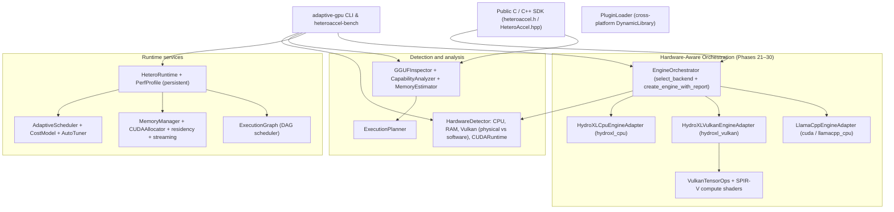
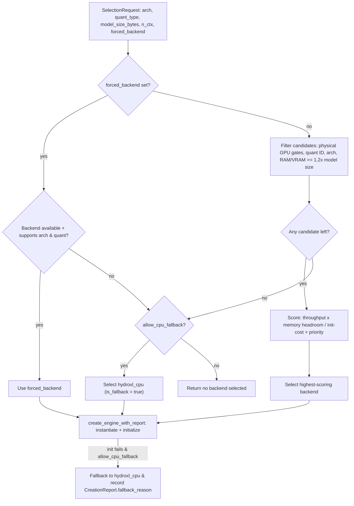
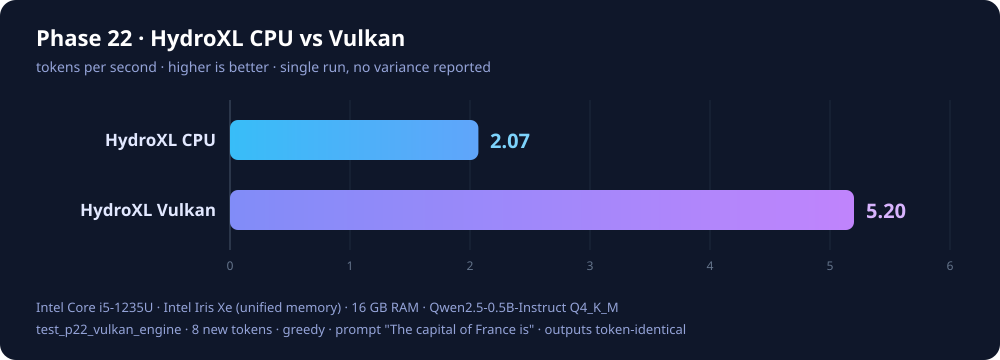
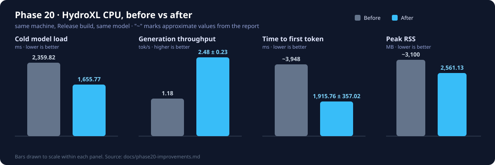

<div align="center">


<br>

**Detect the machine, check what each backend can actually run, plan the execution, and fall back safely.**


[Why](#-why-heteroaccel) · [Status](#-status-at-a-glance) · [Architecture](#-architecture) · [Models & Quants](#-supported-architectures--quantization-types) · [Phases](#-phase-progress) · [Build](#-platform-build-instructions) · [Usage & Examples](#-usage--sdk-examples) · [Benchmarks](#-performance--reproducible-benchmarks) · [Testing](#-testing) · [Limitations](#-known-limitations) · [Layout](#-repository-layout) · [Developer guide](#-developer-guide) · [Troubleshooting](#-troubleshooting)

</div>

HeteroAccel is the runtime layer *around* local LLM inference engines. It inspects CPU, system RAM, physical vs. software Vulkan ICDs, and NVIDIA CUDA driver capabilities; analyzes a GGUF model's architecture, quantization, and memory requirements; plans residency and backend selection; and executes inference through either **llama.cpp** (CPU, Vulkan, or CUDA) or its own dependency-free native engine (**HydroXL**) with automatic CPU fallback.


> [!IMPORTANT]
> **Hardware validation scope.** Every feature documented below is backed by source code and automated CTest targets (`130/130` passing with zero skips). Physical hardware validation and end-to-end benchmarks in this repository were measured on **Intel Core i5-1235U (10C/12T) + Intel Iris Xe Vulkan (16 GB RAM, Windows 11)**. CUDA runtime driver probing, memory management (`cuMemAlloc_v2` / `cuMemcpyHtoD_v2` / `cuMemcpyDtoH_v2`), `GGML_CUDA` compilation, and automatic CUDA-to-CPU fallback are implemented and tested; physical NVIDIA GPU inference validation requires an NVIDIA GPU host and is tracked in [docs/RELEASE_VALIDATION_REPORT.md](docs/RELEASE_VALIDATION_REPORT.md).

## 📑 Contents

[Why HeteroAccel](#-why-heteroaccel) · [Status at a glance](#-status-at-a-glance) · [Architecture](#-architecture) · [Supported architectures & quantization types](#-supported-architectures--quantization-types) · [Phase progress](#-phase-progress) · [Platform build instructions](#-platform-build-instructions) · [Usage & SDK examples](#-usage--sdk-examples) · [Automatic backend selection & fallback](#-automatic-backend-selection--fallback) · [Performance & reproducible benchmarks](#-performance--reproducible-benchmarks) · [Testing](#-testing) · [Known limitations](#-known-limitations) · [Repository layout](#-repository-layout) · [Developer guide](#-developer-guide) · [Troubleshooting](#-troubleshooting) · [Contributing](#-contributing)

---

## 🎯 Why HeteroAccel

Calling an inference engine directly assumes the model fits, the backend works, and the hardware is what you expect. HeteroAccel adds hardware verification, capability filtering, memory estimation, and deterministic fallback in front of that call:

| Problem | What HeteroAccel does |
|---|---|
| ❓ "Will this model run here?" | `analyze`, `plan`, and `ha_model_memory_estimate` inspect the GGUF header/tensors and detected hardware before loading weights. |
| 🔌 Backend detected ≠ backend usable | Backends declare supported GGML quantization IDs, architecture families, physical-GPU gates, and minimum RAM/VRAM; software Vulkan rasterizers (`llvmpipe`, `lavapipe`, `SwiftShader`) are explicitly flagged as `is_software = true` so they are never mistaken for physical GPU acceleration. |
| 💾 Limited RAM / VRAM | Memory manager, residency tracking, streaming, prefetch, LRU/priority eviction, and CUDA Driver API memory allocation (`CUDAAllocator`). |
| 🛟 Backend fails at runtime | `EngineOrchestrator::create_engine_with_report` captures initialization failures and automatically falls back to `hydroxl_cpu`, recording `attempted_backend`, `selected_backend`, `fallback_occurred`, and `fallback_reason`. |
| 🔒 Engine lock-in | Engines sit behind `IInferenceEngine` and `IExecutionEngine`; **HydroXL** (CPU & Vulkan) and **llama.cpp** (CPU, Vulkan & CUDA) share the same orchestration and public C/C++ SDK surface. |
| 📈 Opaque performance | `PerfProfile` persists observed throughput across runs, and `heteroaccel-bench` emits machine-readable JSON reports with full hardware/model metadata. |

---

## 🚦 Status at a glance

Legend: ✅ implemented & hardware-verified · 🧩 implemented & CI/software-verified (pending physical hardware)

| | Area | Status | Notes |
|---|---|---|---|
| ✅ | CPU inference via llama.cpp | Implemented | `llm --cpu`, `run`, `chat`, and `LlamaCppEngineAdapter` (`llamacpp_cpu`). |
| ✅ | Vulkan inference via llama.cpp | Implemented | Built when `HETEROACCEL_ENABLE_VULKAN=ON` (`GGML_VULKAN=ON`). Verified on Intel Iris Xe. |
| ✅ | HydroXL native CPU engine | Implemented | Multi-threaded row-parallel `matvec` across 7 architecture families and 13 GGML quant types. |
| ✅ | HydroXL Vulkan hybrid engine | Implemented | `HydroXLVulkanEngineAdapter` (`hydroxl_vulkan`); SPIR-V compute shaders verified on Intel Iris Xe. |
| ✅ | Hardware-aware orchestrator | Implemented | `EngineOrchestrator` wired to `adaptive-gpu infer`, public C/C++ SDK (`libheteroaccel`), and Python bindings. |
| ✅ | Cross-platform plugin loader | Implemented | Cross-platform `DynamicLibrary` (`LoadLibraryA` on Windows, `dlopen` on Linux/macOS). |
| ✅ | Cross-platform builds & CI | Implemented | GitHub Actions matrix for Windows MSVC, Ubuntu Linux (CPU, Vulkan, CUDA 12.6), and macOS. |
| 🧩 | NVIDIA CUDA backend | Implemented (Hardware Pending) | `-DHETEROACCEL_ENABLE_CUDA=ON` enables `GGML_CUDA`, `CudaRuntime` driver API, `CUDAAllocator`, and `LlamaCppEngineAdapter` (`cuda`). Verified for driver-absence safety and CPU fallback; physical NVIDIA GPU execution is pending an NVIDIA runner. |

---

## 🏗️ Architecture



### 🔀 Inference paths


1. **HydroXL Native Path (`hydroxl_cpu`, `hydroxl_vulkan`)**:
   - Dependency-free GGUF v2/v3 parser, reference-validated dequantizer for 13 GGML tensor types, GPT-2 and SentencePiece tokenizer support, GQA KV-cache, and configurable architecture forward pass.
   - **CPU (`hydroxl_cpu`)**: Persistent worker thread pool (`HydroXLOps`) executing 4-way unrolled row-parallel `matvec`.
   - **Vulkan (`hydroxl_vulkan`)**: Uploads dequantized f32 weights to device-local buffers and dispatches `hydroxl_matvec.comp`, `hydroxl_rmsnorm.comp`, and `hydroxl_elemwise.comp` on the GPU while running RoPE and causal GQA attention on the host.
2. **llama.cpp Engine Path (`cuda`, `llamacpp_cpu`, `llm`, `run`, `chat`)**:
   - Drives `llama.cpp` with CPU, Vulkan (`GGML_VULKAN`), or NVIDIA CUDA (`GGML_CUDA` when `HETEROACCEL_ENABLE_CUDA=ON`) layer offloading (`n_gpu_layers`).

---

## 🧬 Supported Architectures & Quantization Types

Full specifications and test coverage are documented in [docs/SUPPORTED_MODELS_AND_QUANTS.md](docs/SUPPORTED_MODELS_AND_QUANTS.md).

### Supported Model Architectures (HydroXL & Orchestrator)

| Architecture String | Model Family | Normalization | Attention & RoPE | FFN Activation | Final Logit Softcapping |
|---|---|---|---|---|---|
| `llama` | LLaMA / LLaMA 2 / LLaMA 3 | Standard RMSNorm | GQA, Normal RoPE ($\theta = 10000$ or $500000$), optional RoPE scaling | SwiGLU (`ffn_gate` + `ffn_up`) | None |
| `mistral`, `mistral3` | Mistral 7B / Mistral-3 | Standard RMSNorm | GQA, Normal RoPE | SwiGLU | None |
| `qwen2` | Qwen2 / Qwen2.5 | Standard RMSNorm | GQA + QKV biases (`attn_q/k/v.bias`), NeoX half-split RoPE ($\theta = 10^6$) | SwiGLU | None |
| `phi3` | Phi-3 Mini / Medium | Standard RMSNorm | Combined `attn_qkv.weight` (split into Q/K/V) or separate Q/K/V, NeoX RoPE | Combined `ffn_up` `[2*n_ff, n_embd]` or separate `ffn_gate` + `ffn_up` | None |
| `gemma` | Gemma 1 | Gemma `(1 + w)` RMSNorm + $\sqrt{d_{\text{model}}}$ embedding scale | GQA, NeoX RoPE | GeGLU (tanh-approximated GELU gate) | None |
| `gemma2` | Gemma 2 | Gemma `(1 + w)` RMSNorm + post-attention & post-FFN norms + $\sqrt{d_{\text{model}}}$ scale | GQA, Attention logit softcapping (`attn_logit_softcapping`) | GeGLU | `final_logit_softcapping` ($\tanh(\text{logit}/cap) \cdot cap$) |

### Supported GGML Quantization Types (13 Reference-Validated Formats)

Every quantization type listed below is decoded by `HydroXLDequant` and verified against upstream GGML reference implementations in `test_p19_dequant_ref` and `test_p27_quant_decoders`:

| GGML Type ID | Name | Block Size | Bytes / Block | Layout Summary | Status |
|---|---|---|---|---|---|
| `0` | `F32` | 1 | 4 | IEEE-754 float32 | ✅ Verified |
| `1` | `F16` | 1 | 2 | IEEE-754 float16 | ✅ Verified |
| `2` | `Q4_0` | 32 | 18 | `fp16 d` + 16 bytes 4-bit unsigned (`q - 8`) | ✅ Verified |
| `3` | `Q4_1` | 32 | 20 | `fp16 d`, `fp16 m` + 16 bytes 4-bit unsigned (`d*q + m`) | ✅ Verified |
| `6` | `Q5_0` | 32 | 22 | `fp16 d`, 4-byte high bits `qh`, 16 bytes low nibbles (`q - 16`) | ✅ Verified |
| `7` | `Q5_1` | 32 | 24 | `fp16 d`, `fp16 m`, 4-byte `qh`, 16 bytes low nibbles (`d*q + m`) | ✅ Verified |
| `8` | `Q8_0` | 32 | 34 | `fp16 d` + 32 `int8_t` values (`d * qs[i]`) | ✅ Verified |
| `10` | `Q2_K` | 256 | 84 | 16 bytes scales/mins + 64 bytes 2-bit quants + `fp16 d`, `fp16 dmin` | ✅ Verified |
| `11` | `Q3_K` | 256 | 110 | 32 bytes `hmask` + 64 bytes `qs` + 12 bytes packed 6-bit scales + `fp16 d` | ✅ Verified |
| `12` | `Q4_K` | 256 | 144 | `fp16 d`, `fp16 dmin` + 12 bytes packed 6-bit scales/mins + 128 bytes 4-bit quants | ✅ Verified |
| `13` | `Q5_K` | 256 | 176 | `fp16 d`, `fp16 dmin` + 12 bytes scales/mins + 32 bytes `qh` + 128 bytes `qs` | ✅ Verified |
| `14` | `Q6_K` | 256 | 210 | 128 bytes `ql` + 64 bytes `qh` + 16 `int8` scales + `fp16 d` | ✅ Verified |
| `15` | `Q8_K` | 256 | 292 | `float d` + 256 `int8` `qs` + 16 `int16` `bsums` | ✅ Verified |

---

## 🗺️ Phase progress

| Phase | Capability | Status | Notes |
|---|---|---|---|
| 1–2 | Hardware detection; Vulkan compute backend (vector add) | ✅ Implemented | Verified on Intel Iris Xe; logs in [phase2_verification_logs/](phase2_verification_logs/). |
| 3 | llama.cpp integration with Vulkan offload | ✅ Implemented | See [docs/phase3-setup.md](docs/phase3-setup.md). |
| 4 | Unified memory manager; automatic backend selection | ✅ Implemented | Includes real CUDA Driver API allocator (`CUDAAllocator`) added in Phase 26. |
| 5 | Adaptive heterogeneous scheduler, cost model | ✅ Implemented | Multi-backend scheduling and cost estimation. |
| 6 | Model/layer manager, streaming, prefetch | ✅ Implemented | Layer residency and prefetching. |
| 7 | `HeteroRuntime`, `run`, `chat` | ✅ Implemented | Interactive and batch inference via llama.cpp. |
| 8–10 | Profiling, performance history, execution policies, hardening | ✅ Implemented | Auto-tuning and fault tolerance. |
| 11–15 | Engine registry, GGUF inspector, execution planner, residency, DAG graph | ✅ Implemented | `analyze`, `plan`, `residency`, `graph` CLI commands. |
| 16–20 | Native tensor primitives, HydroXL engine, plugin ABI, dequantization, optimizations | ✅ Implemented | Tied embeddings, zero hot-path allocations, multi-threaded dequant. |
| 21–22 | Hardware-aware orchestration & HydroXL Vulkan execution | ✅ Implemented | `EngineOrchestrator` + `VulkanTensorOps` SPIR-V compute pipeline. |
| 23 | Stable public C API and C++ RAII SDK | ✅ Implemented | `heteroaccel.h`, `HeteroAccel.hpp`, `libheteroaccel` shared/static targets. |
| 24 | Native token streaming, cancellation, MemoryEstimator, Python bindings, packaging | ✅ Implemented | `ha_infer_stream`, `ha_session_cancel`, `HeteroAccelConfig.cmake`, `heteroaccel.pc`. |
| 25 | Release readiness (`adaptive-gpu infer`, MIT `LICENSE`) | ✅ Implemented | CLI orchestration command and license verification. |
| 26 | Real NVIDIA CUDA backend & Driver API memory runtime | ✅ Implemented | `HETEROACCEL_ENABLE_CUDA`, `CudaRuntime`, `CUDAAllocator`, `LlamaCppEngineAdapter`, CPU fallback (`test_p26_*`). |
| 27 | HydroXL universal model architectures & 13 GGML quant decoders | ✅ Implemented | LLaMA, Mistral, Qwen2, Phi-3, Gemma 1/2 + Q4_0–Q8_K decoders (`test_p27_*`). |
| 28 | Cross-platform portability & software-Vulkan classification | ✅ Implemented | Windows/Linux/macOS portability, `DynamicLibrary`, `llvmpipe` detection, GitHub Actions CI (`test_p28_*`). |
| 29 | End-to-end benchmarking harness & HydroXL thread-pool `matvec` | ✅ Implemented | `heteroaccel-bench`, 4.36x HydroXL CPU speedup (1.56 → 6.80 tok/s), regression gates (`test_p29_*`). |
| 30 | Documentation audit, version `0.30.0` sync, release validation report | ✅ Implemented | Full release validation report in [docs/RELEASE_VALIDATION_REPORT.md](docs/RELEASE_VALIDATION_REPORT.md). |

---

## 🚀 Platform Build Instructions

### Prerequisites

| Requirement | Needed for |
|---|---|
| **C++17 compiler** | MSVC 2022/2026 (Windows), GCC 11+ or Clang 14+ (Ubuntu Linux), AppleClang 15+ (macOS). |
| **CMake ≥ 3.20** | All platforms. |
| **Git** | First CMake configure fetches `llama.cpp` via `FetchContent` (subsequent configures can pass `-DFETCHCONTENT_UPDATES_DISCONNECTED=ON`). |
| **Vulkan SDK** *(optional)* | Required when `HETEROACCEL_ENABLE_VULKAN=ON` (default) for Vulkan headers, loader, and `glslc`/`glslangValidator` shader compilation. When absent or `-DHETEROACCEL_ENABLE_VULKAN=OFF`, the build cleanly produces a CPU-only runtime. |
| **NVIDIA CUDA Toolkit 12.x** *(optional)* | Required only when `-DHETEROACCEL_ENABLE_CUDA=ON`. Compiles `ggml-cuda` kernels and enables the `cuda` backend in `EngineOrchestrator`. |

### 1. Windows 10/11 (MSVC)

```powershell
git clone https://github.com/Deep455-16/HeteroAccel.git
cd HeteroAccel

# Default build (CPU + Vulkan if Vulkan SDK is installed)
cmake -S . -B build -A x64 -DHETEROACCEL_ENABLE_VULKAN=ON -DHETEROACCEL_ENABLE_CUDA=OFF
cmake --build build --config Release --parallel

# CPU-only build (no GPU SDKs required)
cmake -S . -B build-cpu -A x64 -DHETEROACCEL_ENABLE_VULKAN=OFF -DHETEROACCEL_ENABLE_CUDA=OFF
cmake --build build-cpu --config Release --parallel

# CUDA-enabled build (requires NVIDIA CUDA Toolkit 12.x + nvcc)
cmake -S . -B build-cuda -A x64 -DHETEROACCEL_ENABLE_VULKAN=ON -DHETEROACCEL_ENABLE_CUDA=ON -DHETEROACCEL_CUDA_ARCHITECTURES="75;86;89"
cmake --build build-cuda --config Release --parallel
```

### 2. Ubuntu Linux (GCC / Clang)

```bash
# Install dependencies (Ubuntu 22.04 / 24.04)
sudo apt-get update
sudo apt-get install -y build-essential cmake ninja-build libvulkan-dev vulkan-tools glslang-tools

# CPU + Vulkan build
cmake -S . -B build -G Ninja -DCMAKE_BUILD_TYPE=Release \
  -DHETEROACCEL_ENABLE_VULKAN=ON -DHETEROACCEL_ENABLE_CUDA=OFF
cmake --build build --parallel

# CUDA-enabled build (with CUDA Toolkit installed in /usr/local/cuda)
cmake -S . -B build-cuda -G Ninja -DCMAKE_BUILD_TYPE=Release \
  -DHETEROACCEL_ENABLE_VULKAN=OFF -DHETEROACCEL_ENABLE_CUDA=ON \
  -DCMAKE_CUDA_COMPILER=/usr/local/cuda/bin/nvcc \
  -DHETEROACCEL_CUDA_ARCHITECTURES="75;86;89"
cmake --build build-cuda --parallel
```

### 3. macOS (Apple Silicon / Intel)

```bash
# CPU-only portable build
cmake -S . -B build -G Ninja -DCMAKE_BUILD_TYPE=Release \
  -DHETEROACCEL_ENABLE_VULKAN=OFF -DHETEROACCEL_ENABLE_CUDA=OFF
cmake --build build --parallel
```

### Installation & CMake Package Verification

```powershell
cmake --install build --config Release --prefix build/install_verify
```

Installs `include/heteroaccel/heteroaccel.h`, `include/heteroaccel/HeteroAccel.hpp`, shared/static `heteroaccel` libraries, `lib/cmake/HeteroAccel/HeteroAccelConfig.cmake`, and `lib/pkgconfig/heteroaccel.pc`.

---

## 💻 Usage & SDK Examples

Set `HETEROACCEL_MODEL_PATH` to point to a local GGUF model:

```powershell
$env:HETEROACCEL_MODEL_PATH = "D:\HeteroAccel\Models\Qwen2.5-0.5B-Instruct-Q4_K_M.gguf"
$exe = ".\build\Release\adaptive-gpu.exe"
```

### Hardware Detection & Model Inspection

```powershell
& $exe hardware                    # CPU, RAM, physical vs software Vulkan, and CUDA driver probe
& $exe hardware --json             # Machine-readable hardware report
& $exe analyze $env:HETEROACCEL_MODEL_PATH
& $exe plan    $env:HETEROACCEL_MODEL_PATH
```

### CLI Inference (`infer`, `hydroxl`, `llm`)

```powershell
# 1. Orchestrated inference (auto-selects best available backend with CPU fallback)
& $exe infer --model $env:HETEROACCEL_MODEL_PATH --prompt "The capital of France is" --max-tokens 16

# 2. Force CPU, Vulkan, or CUDA backend explicitly through the orchestrator
& $exe infer --model $env:HETEROACCEL_MODEL_PATH --backend hydroxl_cpu    --prompt "The capital of France is" --max-tokens 16
& $exe infer --model $env:HETEROACCEL_MODEL_PATH --backend hydroxl_vulkan --prompt "The capital of France is" --max-tokens 16
& $exe infer --model $env:HETEROACCEL_MODEL_PATH --backend cuda           --prompt "The capital of France is" --max-tokens 16

# 3. Direct HydroXL native CPU CLI
& $exe hydroxl --model $env:HETEROACCEL_MODEL_PATH --prompt "The capital of France is" --max-tokens 16 --temperature 0

# 4. Direct llama.cpp CLI (CPU or GPU offload)
& $exe llm --model $env:HETEROACCEL_MODEL_PATH --cpu --prompt "What is an integrated GPU?" --max-tokens 64
& $exe llm --model $env:HETEROACCEL_MODEL_PATH --gpu-layers 99 --prompt "What is an integrated GPU?" --max-tokens 64
```

### Public C SDK Example (`examples/c_example.c`)

```c
#include <heteroaccel/heteroaccel.h>
#include <stdio.h>

int main(void) {
    printf("HeteroAccel v%s\n", ha_version_string());
    HaRuntime rt = ha_runtime_create();

    HaError err = HA_OK;
    HaModel model = ha_model_load(rt, "Qwen2.5-0.5B-Instruct-Q4_K_M.gguf", &err);
    HaSession session = ha_session_create(model, &err);

    HaInferParams params = {0};
    params.prompt = "The capital of France is";
    params.max_new_tokens = 8;
    params.temperature = 0.0f;

    HaResult res = ha_infer(session, &params);
    if (res.error == HA_OK) {
        printf("[%s] %.2f tok/s: %s\n", res.backend_used, res.tokens_per_second, res.output_text);
    }

    ha_session_destroy(session);
    ha_model_unload(model);
    ha_runtime_destroy(rt);
    return 0;
}
```

### Public C++17 RAII SDK Example (`examples/cpp_example.cpp`)

```cpp
#include <heteroaccel/HeteroAccel.hpp>
#include <iostream>

int main() {
    ha::Runtime rt;
    ha::Model model = rt.load_model("Qwen2.5-0.5B-Instruct-Q4_K_M.gguf");
    ha::Session session = model.create_session();

    ha::InferParams params;
    params.prompt = "The capital of France is";
    params.max_new_tokens = 8;
    params.temperature = 0.0f;

    // Synchronous inference
    ha::Result res = session.infer(params);
    std::cout << "[" << res.backend_used << "] " << res.output_text << "\n";

    // Native per-token streaming (return false from callback to cancel early)
    session.infer_stream(params, [](const std::string& token_text, int token_id) {
        (void)token_id;
        std::cout << token_text << std::flush;
        return true;
    });
    return 0;
}
```

---

## 🧭 Automatic Backend Selection & Fallback



| Backend ID | Engine | Registered When | Priority | Notes |
|---|---|---|---|---|
| `cuda` | `LlamaCppEngineAdapter` (`GGML_CUDA`) | Built with `HETEROACCEL_ENABLE_CUDA=ON` (available when `CudaRuntime` detects >=1 CUDA device with compute capability >= 5.0) | 30 | Falls back cleanly to `hydroxl_cpu` if CUDA init or VRAM allocation fails. |
| `hydroxl_vulkan` | `HydroXLVulkanEngineAdapter` | `HardwareDetector::has_vulkan()` is true | 20 | Requires a physical Vulkan GPU (`has_physical_vulkan_gpu()`) for automatic selection over CPU. |
| `hydroxl_cpu` | `HydroXLCpuEngineAdapter` | Always | 10 | Universal fallback supporting all 7 architectures and 13 GGML quant formats. |

---

## 📊 Performance & Reproducible Benchmarks

Detailed methodology and optimization analysis are in [docs/BENCHMARKING.md](docs/BENCHMARKING.md). Machine-readable benchmark outputs are stored in [`docs/benchmarks/i5_1235u_iris_xe_qwen25_05b_q4km.json`](docs/benchmarks/i5_1235u_iris_xe_qwen25_05b_q4km.json).

### Running `heteroaccel-bench`

```powershell
.\build\Release\heteroaccel-bench.exe `
  --model D:\HeteroAccel\Models\Qwen2.5-0.5B-Instruct-Q4_K_M.gguf `
  --tokens 16 `
  --runs 1 `
  --concurrent 2 `
  --output docs/benchmarks/i5_1235u_iris_xe_qwen25_05b_q4km.json
```

### Measured End-to-End Results (Intel Core i5-1235U + Intel Iris Xe, Qwen2.5-0.5B-Instruct Q4_K_M)

| Engine / Backend | Cold Load (ms) | TTFT (ms) | Decode (tok/s) | E2E (tok/s) | Peak RSS (MB) | Effective BW (GB/s) | Status |
|---|---|---|---|---|---|---|---|
| `hydroxl_cpu` *(Phase 28 baseline, single-thread matvec)* | 5232.9 | 3199.6 | 1.56 | 1.19 | 2663.5 | 2.91 | Baseline |
| **`hydroxl_cpu` *(Phase 29 thread-pool matvec)*** | **1758.5** | **796.9** | **6.80** | **5.24** | **2662.2** | **12.69** | **4.36x Decode / 4.01x TTFT speedup** |
| `hydroxl_vulkan` *(Intel Iris Xe hybrid GPU/CPU)* | 2691.4 | 1323.1 | 3.74 | 2.96 | 2536.6 | 6.98 | Verified (`gpu_used: true`) |
| `llamacpp_cpu` *(llama.cpp b9999 CPU reference)* | 1087.1 | 190.4 | 21.00 | 16.87 | 3128.4 | 7.93 | Reference |
| `llamacpp_vulkan` *(llama.cpp b9999 Intel Iris Xe)* | 1300.9 | 127.0 | 31.34 | 26.78 | 3129.0 | 11.83 | Reference (`gpu_used: true`) |

*Greedy decoding equivalence (`test_p29_real_model_equiv`):* On `Qwen2.5-0.5B-Instruct-Q4_K_M.gguf` with prompt `"The capital of France is"` (`temperature = 0`), both `hydroxl_cpu` and `llamacpp_cpu` generate the exact same output (`" Paris.\nThe capital"`).

### Historical Phase 20 & Phase 22 Charts





---

## 🧪 Testing

```powershell
# Run the complete 130-test suite in Release mode
ctest --test-dir build -C Release --output-on-failure --parallel 2

# Run Phase 26–29 verification suites
ctest --test-dir build -C Release -R "test_p26|test_p27|test_p28|test_p29" --output-on-failure
```

- **130 automated test targets** registered in `tests/CMakeLists.txt`.
- Latest full-suite verification on Windows 11 (Intel Core i5-1235U + Intel Iris Xe): **`100% tests passed, 0 tests failed, 0 skipped out of 130`**.
- **Phase 26 (`test_p26_*`)**: CUDA Driver API probing, `CUDAAllocator` allocation/transfer/cleanup, `LlamaCppEngineAdapter` registration, and CUDA-to-CPU fallback.
- **Phase 27 (`test_p27_*`)**: Exact numerical verification for all 13 GGML quantization decoders (`Q4_0` through `Q8_K`, `F16`, `F32`) and synthetic GGUF v3 end-to-end forward-pass tests for `llama`, `mistral`, `qwen2`, `phi3`, `gemma`, and `gemma2`.
- **Phase 28 (`test_p28_*`)**: Cross-platform `DynamicLibrary`, filesystem/threading portability, and software-Vulkan (`llvmpipe`/`lavapipe`/`SwiftShader`) rejection.
- **Phase 29 (`test_p29_*`)**: End-to-end performance regression gates, multi-threaded `matvec` numerical equivalence, and real-model greedy token equivalence between HydroXL and `llama.cpp`.

---

## ⚠️ Known Limitations

1. **CUDA Physical Hardware Execution Pending**:
   - The CUDA backend (`CudaRuntime`, `CUDAAllocator`, `LlamaCppEngineAdapter`, `GGML_CUDA` CMake integration, and CPU fallback) is fully implemented and verified on compilation and driver-absence/fallback paths. However, the primary validation machine for this release has an Intel Iris Xe integrated GPU and no physical NVIDIA GPU; actual hardware execution on a physical NVIDIA GPU remains pending an NVIDIA hardware runner.
2. **HydroXL F32 Weight Expansion in RAM**:
   - HydroXL dequantizes model weights to 32-bit floats (`float32`) during model initialization rather than executing fused quantized matrix-vector kernels directly on compressed blocks. Consequently, HydroXL uses ~4x the raw GGUF file size in host RAM (~2.66 GB RSS for a 0.5B model). For memory-constrained quantized inference without F32 expansion, use the `llamacpp_cpu`, `llamacpp_vulkan`, or `cuda` backends.
3. **HydroXL Vulkan Hybrid Host/Device Transfers**:
   - `HydroXLVulkanEngineAdapter` keeps weights resident in Vulkan `DEVICE_LOCAL` buffers and executes `matvec`, `rmsnorm`, and `swiglu` on the GPU, but activations cross the host/device staging boundary per operation while RoPE and causal attention run on the CPU. On discrete PCIe GPUs or high-core-count CPUs, PCIe transfer latency can make `hydroxl_cpu` faster than `hydroxl_vulkan`.
4. **Single-GPU Selection**:
   - `HardwareDetector::best_gpu()` selects the single physical GPU with the largest dedicated VRAM. Multi-GPU tensor parallelism across multiple discrete GPUs is not implemented in HydroXL.
5. **Plugin Loader Scope**:
   - `PluginLoader` provides cross-platform shared-library discovery and ABI v1 verification (`DynamicLibrary`), used for runtime plugin extensions (`hydroxl_test_plugin`), separate from `EngineOrchestrator`'s built-in engine factories.

---

## 🗂️ Repository Layout

```text
.
├── CMakeLists.txt            Root build configuration (CPU, Vulkan, CUDA options, FetchContent llama.cpp)
├── include/heteroaccel/      Public C API (heteroaccel.h) and C++17 RAII SDK (HeteroAccel.hpp)
├── src/
│   ├── platform/             Phase 26/28: Cross-platform DynamicLibrary (LoadLibrary / dlopen)
│   ├── cuda/                 Phase 26: CudaRuntime Driver API loader, device probe, HtoD/DtoH transfers
│   ├── hardware/             Phase 1/28: CPU, RAM, DXGI, Vulkan (physical vs software), CUDA detectors
│   ├── gpu/                  Phase 2: VulkanBackend, SPIR-V shader locator, CPU reference
│   ├── llm/ inference/       Phase 3/7: llama.cpp backend wrapper, HeteroRuntime
│   ├── mem/ backend/         Phase 4/26: MemoryManager, CUDAAllocator, BackendSelector
│   ├── scheduler/ profiler/  Phase 5/8/9: AdaptiveScheduler, CostModel, AutoTuner, Profiler
│   ├── model/                Phase 6/14: ModelManager, Residency, StreamingEngine, Prefetch
│   ├── engine/               Phase 11: IExecutionEngine, ExecutionEngineRegistry
│   ├── analysis/ planner/    Phase 12/13: GGUFInspector, CapabilityAnalyzer, ExecutionPlanner
│   ├── execution/            Phase 15: ExecutionGraph and DAG scheduler
│   ├── primitives/           Phase 16: Tensor, HostBuffer, CPU ops
│   ├── hydroxl/              Phase 17–29: GGUF loader, 7 architectures, 13 quant decoders, thread-pool ops, VulkanTensorOps
│   ├── plugin/               Phase 18/28: Plugin ABI v1 and cross-platform PluginLoader
│   ├── orchestration/        Phase 21–29: EngineOrchestrator, HardwareDetector, HydroXL & LlamaCpp adapters
│   ├── sdk/                  Phase 23–25: Public C/C++ SDK implementation, MemoryEstimator, PerfProfile
│   ├── benchmark/            Phase 29: EndToEndBench harness and heteroaccel-bench CLI
│   └── cli/main.cpp          adaptive-gpu CLI command dispatcher
├── examples/                 Public C (c_example.c) and C++ (cpp_example.cpp) consumer examples
├── python/                   Python ctypes bindings (heteroaccel.py) and unit tests
├── shaders/                  GLSL compute shaders compiled to SPIR-V at build time
├── tests/                    130 automated CTest executables (Phases 1–29)
├── docs/                     Architecture notes, benchmark reports, and RELEASE_VALIDATION_REPORT.md
├── LICENSE                   MIT License
└── Security.md               Security policy and vulnerability reporting
```

---

## 🛠️ Developer Guide

### Add an Inference Backend to the Orchestrator

1. Implement `IInferenceEngine` (`src/orchestration/IInferenceEngine.h`): `initialize`, `run`, `run_streaming`, `shutdown`, `backend_id`, `is_ready`.
2. Populate a `BackendCapabilities` descriptor (`supported_quant_types`, `supported_architectures`, `requires_vulkan`, `requires_cuda`, `min_vram_bytes`, `min_ram_bytes`, `priority`).
3. Register the descriptor and factory in `src/orchestration/OrchestratorInit.cpp` (`register_default_backends`).
4. Add unit and integration tests under `tests/` and register them in `tests/CMakeLists.txt`.

---

## 🩺 Troubleshooting

| Symptom | Likely cause and fix |
|---|---|
| CMake warns "Neither glslangValidator nor glslc was found" | Vulkan SDK `Bin` directory is not on `PATH`. CPU builds still succeed; install the Vulkan SDK if you need `hydroxl_vulkan` shader compilation. |
| `cuda` backend reports `not available on current hardware` | Built without `-DHETEROACCEL_ENABLE_CUDA=ON` or no NVIDIA GPU / `nvcuda.dll` / `libcuda.so.1` driver is present. When `allow_cpu_fallback` is true, `EngineOrchestrator` automatically falls back to `hydroxl_cpu`. |
| CMake reconfigure stalls in offline/sandboxed environments | Pass `-DFETCHCONTENT_UPDATES_DISCONNECTED=ON` after the initial `llama.cpp` clone so CMake does not attempt a network `git fetch`. |
| Software Vulkan adapter (`llvmpipe`) detected on Linux CI | HeteroAccel flags `llvmpipe`/`lavapipe`/`SwiftShader` with `is_software = true` and `has_physical_vulkan_gpu() == false`, preventing slow CPU-emulated Vulkan from outranking native multi-threaded CPU execution. |

---

## 🤝 Contributing

1. Build in Release mode and run `ctest --test-dir build -C Release --output-on-failure` to ensure 100% of tests pass with zero skips.
2. Validate numerical changes against upstream reference implementations (`ggml` for quantization decoders, `llama.cpp` for end-to-end model outputs).
3. Never claim hardware validation or benchmark numbers that were not measured on real hardware.
4. Report security issues privately as described in [Security.md](Security.md).

## 🔗 Links

- Repository: <https://github.com/Deep455-16/HeteroAccel>
- Supported Models & Quantizations: [docs/SUPPORTED_MODELS_AND_QUANTS.md](docs/SUPPORTED_MODELS_AND_QUANTS.md)
- Benchmarking Guide: [docs/BENCHMARKING.md](docs/BENCHMARKING.md)
- Release Validation Report (v0.30.0): [docs/RELEASE_VALIDATION_REPORT.md](docs/RELEASE_VALIDATION_REPORT.md)
- Security Policy: [Security.md](Security.md)

<div align="center">

<sub>HeteroAccel v0.30.0 · detect · check · plan · fall back safely</sub>

</div>
